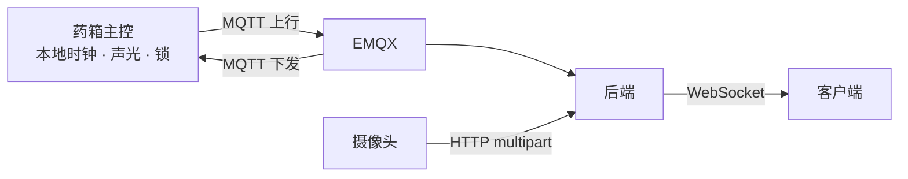

# 单片机（药箱主控）与后端 · API 与配置对接说明

> 适用对象：药箱主控固件（单片机）、后端联调人员。
> 协议契约以 [`medbox-spec/03_设备接入协议_MQTT.md`](../../medbox-spec/03_设备接入协议_MQTT.md) 和 [`medbox-spec/02b_设备管理.md`](../../medbox-spec/02b_设备管理.md) 为准；本文是双方共用的**准备步骤 + 参数确认单 + Topic/Payload 契约 + 设备侧实现清单**。
> 调试测试的命令与执行顺序见 [`docs/后端与单片机调试测试流程.md`](../调试测试流程/后端与单片机调试测试流程.md)；摄像头 HTTP 直报见 [`docs/摄像头与后端API对接.md`](./摄像头与后端API对接.md)。CI 与自动化测试可用 [`medbox-server/tools/device-sim`](../../medbox-server/tools/device-sim/README.md) 跑通链路（无真机时亦可）。

---

## 0. 链路与职责边界



| 角色 | 负责 | 不负责 |
|------|------|--------|
| **单片机** | 本地时钟、计划持久化、到点声光与解锁、遥测 / 异常上报、回执 ack | 服药事件上报（由摄像头做）、运行图像识别 |
| **后端** | 登记设备、下发「时间 → 格号」排程、判漏服、统计、告警 | 下发实时声光 / 解锁指令、记录格内药品、运行图像识别 |

> 三条关键边界：**后端不下发实时提醒**（计划下发后设备本地闭环）；**服药事件不走 MQTT**（摄像头 HTTP 直报后端）；**后端只建模「格号 + 时间」**（格号 1 / 2 / 3 由固件固定对应早 / 中 / 晚，后端不记录、不校验格内放什么药）。

---

## 1. 联调前准备（后端侧执行）

### 1.1 环境检查

- [ ] PostgreSQL 已启动，后端能正常启动（Flyway 自动建表）
- [ ] EMQX 已启动，`localhost:1883` 可连
- [ ] 后端端口 `8080`、context-path `/medbox`
- [ ] 局域网内其它机器能访问：`http://<后端内网IP>:8080/medbox/api/v1`

```bash
BASE=http://localhost:8080/medbox/api/v1
# 局域网联调时换成：BASE=http://<后端内网IP>:8080/medbox/api/v1
```

### 1.2 方式 A：测试数据一键播种（仅开发 / QA 联调）

需要后端以 `medbox.devtools.enabled=true` 启动（默认关闭）：

```bash
MEDBOX_DEVTOOLS_ENABLED=true ./gradlew bootRun
curl -s -X POST "$BASE/_debug/seed?reset=true" | jq
TOKEN=$(curl -s -X POST "$BASE/_debug/seed" | jq -r '.data.guardianToken')
```

播种内容：监护人 `u-debug-guardian`（`13800001234 / 123456`）、老人 `e-1001`（`13800008888 / 123456`）、ACTIVE 监护关系、主控 `BOXA-DEBUG-01`（环境读数直接挂主控，无传感器子设备）、药品档案 / **单格排程计划**（只排 1 号格，开格时间 = 播种时刻 +2 分钟）。

> ⚠️ `BOXA-DEBUG-01` 是种子专用编号，`reset=true` 会按它删设备。**真机不能复用，请新建设备**。

### 1.3 方式 B：真机正式登记

**第 1 步：登录拿监护人 token**

```bash
TOKEN=$(curl -s -X POST "$BASE/auth/login" \
  -H 'Content-Type: application/json' \
  -d '{"account":"13800001234","password":"123456"}' | jq -r '.data.token')
```

**第 2 步：确认监护关系为 ACTIVE**（种子账户已就绪，手动注册的账户才需要）

```bash
# 监护人发起
curl -s -X POST "$BASE/users/<elderId>/guardians" \
  -H "Authorization: Bearer $TOKEN" | jq

# 老人登录后查待确认，拿到 relationId
ETOKEN=$(curl -s -X POST "$BASE/auth/login" -H 'Content-Type: application/json' \
  -d '{"account":"<老人手机号>","password":"<密码>"}' | jq -r '.data.token')
curl -s -H "Authorization: Bearer $ETOKEN" "$BASE/users/guardians/pending" | jq

# 老人确认
curl -s -X PATCH "$BASE/users/guardians/<relationId>/accept" \
  -H "Authorization: Bearer $ETOKEN" -H 'Content-Type: application/json' -d '{}' | jq
```

**第 3 步：登记药箱**（必须用监护人 token；`deviceId` 由设备固件生成并提供给监护人）

```bash
curl -s -X POST "$BASE/devices/register" \
  -H "Authorization: Bearer $TOKEN" \
  -H 'Content-Type: application/json' \
  -d '{
    "deviceId": "BOXA1001",
    "elderId": "e-1001",
    "productKey": "medbox-box",
    "timezone": "Asia/Shanghai"
  }' | jq
```

**第 4 步：验证**

```bash
curl -s -H "Authorization: Bearer $TOKEN" "$BASE/devices" | jq
curl -s -H "Authorization: Bearer $TOKEN" "$BASE/devices/BOXA1001" | jq
```

预期：列表出现 `BOXA1001`，`onlineState=OFFLINE`；详情里能看到最新遥测（上报后）。

**登记规则（必须提前知道）**

| 情况 | 结果 |
| --- | --- |
| 老人 token 调 register | 40301 |
| 监护关系仍为 PENDING | 40302 |
| 编号已存在 | 40901，不覆盖、不改绑 |
| 改 deviceId / productKey | 本期**没有解绑或编辑接口**，只能换新编号重新登记，或清库 |
| 设备未登记就发 MQTT | 消息被静默丢弃（仅 DEBUG 日志），表现为"永远离线" |

> `deviceId` 由设备固件生成并固化（如何生成 / 展示属设备实现，后端只校验格式与唯一）；登记完成即代表这台机器的身份。**不再有传感器子设备 ID**。

---

## 2. 参数确认单

> 双方逐项确认后签字。任一"身份"项改动都需要重新登记设备。

### 2.1 身份（定死后不可改）

| 项 | 取值 | 说明 |
|----|------|------|
| 主控 deviceId | `BOXA1001` | 由设备固件生成并固化；4~64 位 `[A-Za-z0-9_-]`，全库唯一 |
| productKey | `medbox-box` | topic 第 2 层 |
| 时区 | `Asia/Shanghai` | 计划时间按此墙钟 |
| msgId 前缀 | `BOXA1001-` | 后接 10 位递增序号，掉电不归零 |
| MQTT clientId | `BOXA1001` | **必须等于 deviceId** |
| 药格编号 | `1` / `2` / `3` | **固件固定对应早 / 中 / 晚**，不可配置；后端只按格号下发时间 |

> 不再有温湿度 / 光照 / 摄像头子设备 ID：摄像头抓拍路径直接用主控 `deviceId`，环境遥测也不带来源 ID。

### 2.2 连接参数

| 项 | 取值 | 状态 |
|----|------|------|
| MQTT Broker | `tcp://<EMQX内网IP>:1883` | 待填 IP |
| MQTT 认证 | 本期匿名，无用户名密码 | 固定 |
| 加密 | 明文，无 TLS | 固定 |
| 后端 HTTP | `http://<后端内网IP>:8080/medbox/api/v1` | 待填 IP |
| Wi-Fi SSID / 密码 | `____________` | 待填 |
| 设备 IP | DHCP 静态保留 `____________` | 待填 |
| KeepAlive | 60s | 固定 |
| 遗嘱 LWT | topic `medbox/medbox-box/BOXA1001/status`，`{"online":false}`，retained | 固定 |
| 上线消息 | 同 topic，`{"online":true}`，retained | 固定 |
| QoS | 遥测 0/1、异常 1、ack 1、下行 1 | 固定 |
| MQTT 版本 / clean session | `____________` | 待确认（影响设备离线时下行能否补收） |

### 2.3 Topic 与 Payload 契约

| 方向 | Topic | 内容 |
| ---- | ----- | ---- |
| 上行 | `medbox/medbox-box/BOXA1001/up/telemetry` | `{msgId, ts, temperature, humidity}` 或 `{msgId, ts, lux}`，主控直接上报，不带 `sensorId` |
| 上行 | `medbox/medbox-box/BOXA1001/up/event/error` | `{msgId, ts, type, detail}`，`type` = `DOOR_TIMEOUT` / `CAMERA_FAILED` / `HW_FAULT` |
| 上行 | `medbox/medbox-box/BOXA1001/up/ack` | `{msgId, ts, ackFor, result:"OK"/"FAILED", reason}` |
| 下行 | `medbox/medbox-box/BOXA1001/down/schedule` | `{msgId, planId, op:"UPSERT"/"DELETE", slots:[{cellNo,time}], repeat, alarm:{missAfterMin}, needAck}` |
| 下行 | `medbox/medbox-box/BOXA1001/down/command` | `{msgId, cmd:"REBOOT"/"CALIBRATE", params, needAck}` |

- [ ] 所有上行必须带 `msgId`，缺了会被后端直接丢弃
- [ ] `msgId` 序号**持久化**，重启不归零
- [ ] 下行消息 `needAck:true` 时必须回 `up/ack`；5s 未回后端重发，3 次后判失败
- [ ] `down/schedule` 必须**本地持久化**，重启后继续生效
- [ ] `slots[].time` 是**设备本地墙钟时间**（`HH:mm`），不是 UTC；`slots[].cellNo` 取 1 / 2 / 3
- [ ] **缺失的格号 = 该格当天不排程**（不提醒、不解锁）；后端不下发药品、剂量
- [ ] 保存计划后后端**立即下行一次**，不判断设备在线；下行 QoS1 且 `retained=false`，设备离线时能否补收取决于 broker 会话（`clean session=false` 才保留）——**联调时先上线再保存计划**
- [ ] 后端**不下发**蜂鸣（`BUZZ`）与开格（`UNLOCK`），由设备本地或客户端本地触发

### 2.4 待拍板事项

1. 单片机是否带 RTC、是否 NTP 校时。
2. deviceId 的自生成与固化方式（属设备侧实现，后端只校验格式与唯一）。
3. 匿名 MQTT 是否仅用于局域网演示（后续是否加 EMQX ACL）。
4. MQTT 协议版本与 clean session 取值。

---

## 3. 设备侧实现清单

### 3.1 连接

- [ ] deviceId 由固件自生成并固化；clientId = deviceId
- [ ] 上线发布 retained `{"online":true}`，设置 LWT `{"online":false}`（retained）
- [ ] KeepAlive 60s
- [ ] 断线重连后重新订阅下行 topic
- [ ] 订阅 `medbox/medbox-box/BOXA1001/down/#`

### 3.2 上行

- [ ] 温湿遥测：`temperature` / `humidity`，不带 `sensorId`
- [ ] 光照遥测：`lux`，不带 `sensorId`
- [ ] 异常事件：门超时 / 摄像头失败 / 硬件故障
- [ ] 断网缓存、联网补传
- [ ] 所有报文带持久化递增 `msgId`

### 3.3 下行

- [ ] 解析 `down/schedule` 的 `UPSERT` / `DELETE`
- [ ] 计划落本地存储，重启不丢
- [ ] 按 `slots` 的 `cellNo` 到点对该格声光 + 解锁；未出现的格号不动作
- [ ] 解析 `down/command` 的 `REBOOT` / `CALIBRATE`
- [ ] 处理后回 `up/ack`（`ackFor` = 下行 msgId）

---

## 4. 附：完整报文示例

### 4.1 上行 · 遥测

```json
{ "msgId":"BOXA1001-0000000001", "ts":1759474487000,
  "temperature":24.6, "humidity":52.1 }
```

```json
{ "msgId":"BOXA1001-0000000002", "ts":1759474488000,
  "lux":120 }
```

### 4.2 上行 · 设备异常

```json
{ "msgId":"BOXA1001-0000000004", "ts":1759474512000,
  "type":"DOOR_TIMEOUT", "detail":"仓门开启超过 60s 未关闭" }
```

### 4.3 上行 · 回执

```json
{ "msgId":"BOXA1001-0000000005", "ts":1759474520000,
  "ackFor":"d-001", "result":"OK", "reason":null }
```

### 4.4 下行 · 同步计划

```json
{ "msgId":"d-001", "planId":"p-3301", "op":"UPSERT",
  "slots":[ { "cellNo":1, "time":"08:00" },
            { "cellNo":2, "time":"12:30" },
            { "cellNo":3, "time":"18:00" } ],
  "repeat":"DAILY",
  "alarm":{"missAfterMin":15},
  "needAck":true }
```

### 4.5 下行 · 控制命令

```json
{ "msgId":"d-102", "cmd":"REBOOT", "params":{}, "needAck":true }
```

---

## 5. 契约相关边界

| 现象 | 契约层原因 |
|------|-----------|
| 设备一直离线 | 未登记 / clientId ≠ deviceId / EMQX 无此连接；未登记的上行会被静默丢弃 |
| 上行发了没反应 | 缺 `msgId` / `msgId` 重复（去重保留 7 天）/ topic 层级不对 |
| 下行收不到 | 固件订阅的 `productKey` 与登记时不一致 / 设备离线 / 未订阅 `down/#` |
| 命令、计划不生效 | 命令要求设备在线；计划下行 `retained=false`，离线期间可能丢失 |
| 到点该格不动作 | `cellNo` 不在 `slots` 里 / 计划未启用 / 设备本地时钟不准 |

调试命令、验收顺序与排查步骤见 [`后端与单片机调试测试流程.md`](../调试测试流程/后端与单片机调试测试流程.md)。
