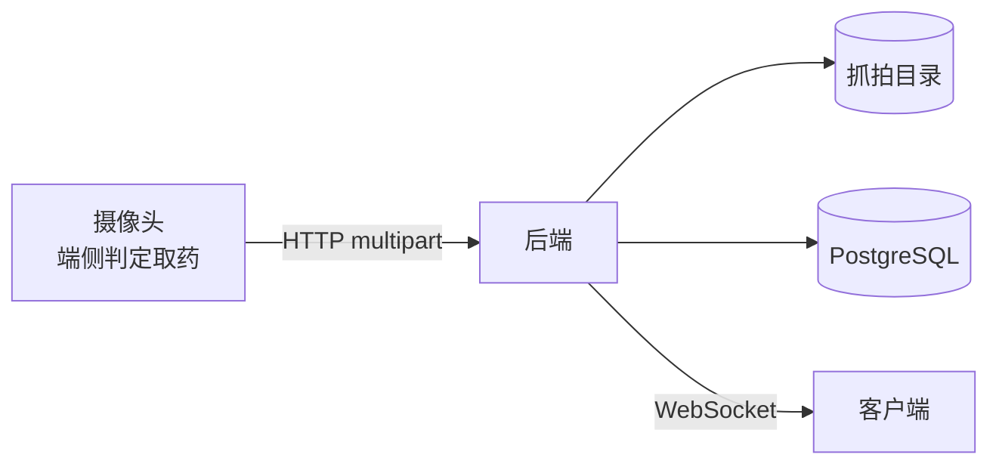

# 摄像头与后端 · API 与配置对接说明

> 适用对象：摄像头固件、后端联调人员。
> 协议契约以 [`medbox-spec/03_设备接入协议_MQTT.md`](../../medbox-spec/03_设备接入协议_MQTT.md) 第 4 章和 [`medbox-spec/02b_设备管理.md`](../../medbox-spec/02b_设备管理.md) 为准；本文是双方共用的**准备步骤 + 参数确认单 + HTTP 契约 + 固件侧实现清单 + curl 对照**。
> 联调调试以真实摄像头为主，命令与执行顺序见 [`docs/后端与摄像头调试测试流程.md`](../调试测试流程/后端与摄像头调试测试流程.md)；单片机 MQTT 对接见 [`docs/单片机与后端API对接.md`](./单片机与后端API对接.md)。`device-sim camera` 是 Mock，仅用于 CI 与自动化测试（见 [`medbox-server/tools/device-sim`](../../medbox-server/tools/device-sim/README.md)）。

---

## 0. 链路与职责边界



| 角色 | 负责 | 不负责 |
|------|------|--------|
| **摄像头** | 端侧判定该格是否被取走，HTTP 直连后端上报 **格号 + 取药结论** | 经 MQTT 上报、经单片机中转、把药品信息写进上报 |
| **后端** | 接收抓拍、留证存储、关联服药记录、判漏服与告警 | 运行图像识别、记录格内药品、下发实时控制 |

> **关键边界：摄像头 HTTP multipart 直报后端，不经 MQTT、不经单片机；路径用主控 `deviceId`，没有摄像头子设备 ID，也没有 `X-Device-Id` 头。**

---

## 1. 联调前准备（后端侧执行）

### 1.1 环境检查

- [ ] PostgreSQL 已启动，后端能正常启动（Flyway 自动建表）
- [ ] 后端端口 `8080`、context-path `/medbox`
- [ ] 抓拍目录 `medbox.capture.dir` 可写（默认 `/var/medbox/captures`，本地联调建议覆盖）
- [ ] 单文件 ≤ 10MB（后端 `spring.servlet.multipart.max-file-size`）

```bash
BASE=http://localhost:8080/medbox/api/v1
# 局域网联调时换成：BASE=http://<后端内网IP>:8080/medbox/api/v1

# 起后端（devtools 用于播种；抓拍目录指到可写位置）
cd medbox-server
MEDBOX_DEVTOOLS_ENABLED=true MEDBOX_CAPTURE_DIR=/tmp/medbox-captures ./gradlew bootRun
```

### 1.2 方式 A：一键播种（仅开发 / QA 联调）

```bash
curl -s -X POST "$BASE/_debug/seed?reset=true" | jq
TOKEN=$(curl -s -X POST "$BASE/_debug/seed" | jq -r '.data.guardianToken')
```

播种内容里与摄像头相关的固定 ID：主控 `BOXA-DEBUG-01`、老人 `e-1001`、计划 `p-3301`（只排 1 号格，开格时间 = 播种时刻 +2 分钟）。抓拍路径直接用主控 `deviceId`，**不再有摄像头子设备 ID**。

> ⚠️ `BOXA-DEBUG-01` 是种子专用编号，`reset=true` 会按它删设备。**真机不能复用**。

### 1.3 方式 B：真机正式登记（设备身份由主控固件提供）

摄像头上报的路径 `deviceId` 必须是已登记的主控编号；登记步骤见 [`单片机与后端API对接.md` §1.3](./单片机与后端API对接.md)。简化命令：

```bash
TOKEN=$(curl -s -X POST "$BASE/auth/login" -H 'Content-Type: application/json' \
  -d '{"account":"13800001234","password":"123456"}' | jq -r '.data.token')

curl -s -X POST "$BASE/devices/register" -H "Authorization: Bearer $TOKEN" \
  -H 'Content-Type: application/json' \
  -d '{"deviceId":"BOXA1001","elderId":"e-1001","productKey":"medbox-box","timezone":"Asia/Shanghai"}' | jq
```

未登记设备上报送抓拍会返回 `40301`（路径 `deviceId` 查不到归属）。

---

## 2. 参数确认单

### 2.1 身份与语义

| 项 | 取值 | 说明 |
|----|------|------|
| 路径 `deviceId` | `BOXA1001` | 药箱主控 ID，**不是摄像头子设备 ID** |
| 药格 `cellNo` | `1` / `2` / `3` | 固件固定对应早 / 中 / 晚；`planId` 非空时必带 |
| 取药结论 | `TAKEN` / `UNTAKEN` | 端侧二值判定，后端不运行图像识别 |
| 时区 | `Asia/Shanghai` | `capturedAt` 用 ISO-8601 **UTC** 上报（`Z` 结尾） |

> 后端不记录、不校验格内放什么药；抓拍只上报「格号 + 取药结论」，药品档案与格位无关。

### 2.2 连接参数

| 项 | 取值 | 状态 |
|----|------|------|
| 后端 HTTP | `http://<后端内网IP>:8080/medbox/api/v1` | 待填 IP |
| 端点 | `POST /devices/{deviceId}/captures` | 固定 |
| 请求格式 | `multipart/form-data` | 固定 |
| 鉴权 | **不需要用户 JWT**；后端按路径 `deviceId` 解析归属 | 固定 |
| 图片大小 | 单文件 ≤ 10MB | 固定 |
| 摄像头联网方式 | 独立联网或挂主控 | 待拍板（协议只约束"摄像头 → 后端"这一跳 HTTP） |

### 2.3 端点与表单字段

| 字段 | 必填 | 取值 / 说明 |
|------|:----:|-------------|
| `takenResult` | 是 | `TAKEN` / `UNTAKEN` |
| `cellNo` | 条件 | `planId` 非空时必带，1 / 2 / 3；缺失 / 越界 → `40001` |
| `planId` | 否 | 关联计划 ID，如 `p-3301` |
| `capturedAt` | 否 | ISO-8601 UTC，省略时后端取当前 UTC |
| `reason` | 否 | `NORMAL` / `MANUAL` |
| `file` | 条件 | `UNTAKEN` **必须带**；`TAKEN` **不带图** |

### 2.4 去重与留证规则

- 同一 `planId + cellNo` **60s 内重复上报只保留第一张**；连续自测不同结论请换 `cellNo` 或时间槽。
- 同一计划同一格同一时间槽只落一条服药记录（`med_record` 的 `(plan_item_id, plan_time)` / `(plan_id, cell_no, plan_time)` 约束）。
- `UNTAKEN` 附原图留证；`TAKEN` 不附图。响应上判断"有无文件"看 `sizeBytes` / `fileToken` 是否为空——`mime` 因 DB 默认值可能仍回显 `image/jpeg`，不代表真有文件。
- 抓拍详情返回的 `fileToken` 有效期 **5 分钟**，供 APP 拼 `/captures/{captureId}/file?token=...` 读取图片流。
- 已上报 `UNTAKEN` 的会落在记录里并附抓拍图，**不重复生成漏服告警**；只有容忍窗口内一条上报都没收到（且设备在线）才判 `MISS`。

---

## 3. 固件侧实现清单

- [ ] 取药结论端侧判定为二值 `TAKEN` / `UNTAKEN`
- [ ] 上报**格号 `cellNo`（1/2/3）**；`planId` 非空时 `cellNo` 必带
- [ ] HTTP multipart 直报后端，不经 MQTT、不经单片机，路径用主控 `deviceId`，无 `X-Device-Id`
- [ ] `UNTAKEN` 附原图，`TAKEN` 不附图
- [ ] `capturedAt` 按 UTC 构造，不用本地墙钟直接当 UTC 发
- [ ] 单文件控制在 10MB 以内

---

## 4. HTTP 契约对照（真机 curl）

### 4.1 真机固件最小 HTTP 契约

```bash
# TAKEN：不附图
curl -s -X POST "$BASE/devices/BOXA1001/captures" \
  -F reason=NORMAL -F planId=p-3301 -F cellNo=1 \
  -F takenResult=TAKEN -F capturedAt=2026-11-12T08:00:30Z | jq

# UNTAKEN：必须带 file
curl -s -X POST "$BASE/devices/BOXA1001/captures" \
  -F reason=NORMAL -F planId=p-3301 -F cellNo=1 \
  -F takenResult=UNTAKEN -F capturedAt=2026-11-12T08:00:30Z \
  -F file=@/path/to/capture.jpg | jq
```

### 4.2 查询结果形状（供固件 / 客户端对照）

```bash
# 列表：R<PageResult>，数据在数据体的 list 字段
curl -s -H "Authorization: Bearer $TOKEN" "$BASE/captures?elderId=e-1001" | jq

# 详情：含 captureId / cellNo / takenResult / sizeBytes / capturedAt / fileToken 等
curl -s -H "Authorization: Bearer $TOKEN" "$BASE/captures/<captureId>" | jq

# 图片流：fileToken 来自详情，5 分钟有效
curl -s -o /tmp/capture.jpg "$BASE/captures/<captureId>/file?token=<fileToken>"
```

> `device-sim camera` 是 Mock 模拟对端，仅用于 CI 与自动化测试；其命令见 [`后端与摄像头调试测试流程.md` §4](../调试测试流程/后端与摄像头调试测试流程.md)。联调验收以真机上报为准。

---

## 5. 契约相关边界

| 现象 | 契约层原因 |
|------|-----------|
| 抓拍 `40301` | 路径 `deviceId` 未登记（不是摄像头 ID）；fileToken 失效也走 40101/40301 |
| 抓拍 `40001` | `planId` 非空时 `cellNo` 缺失 / 越界；`UNTAKEN` 没带 `file` |
| 上传 500 | `medbox.capture.dir` 不可写，或文件 > 10MB |
| 同一格连报两次只生效一次 | 60s 去重 + 同计划项同时间槽唯一约束，换 `cellNo` 或时间槽 |
| `TAKEN` 却回显 `mime=image/jpeg` | DB 默认值所致，看 `sizeBytes` / `fileToken` 是否为空判断有无文件 |
| 没生成漏服告警 | 容忍窗口未到 / 设备离线默认跳过 / 已有该时间槽记录 |
| `onTime=false` 不符合预期 | 后端按 `ts` 与计划时间 + 容忍现算，payload 里的 `onTime` 被忽略；`capturedAt` 用 UTC |

调试命令、验收顺序与排查步骤见 [`后端与摄像头调试测试流程.md`](../调试测试流程/后端与摄像头调试测试流程.md)。
