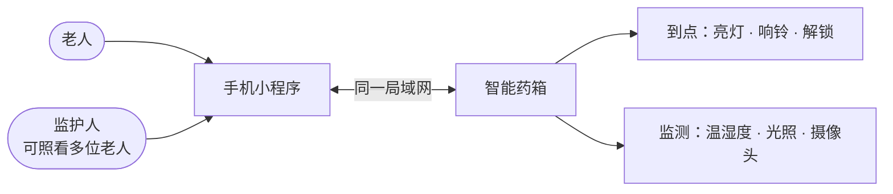
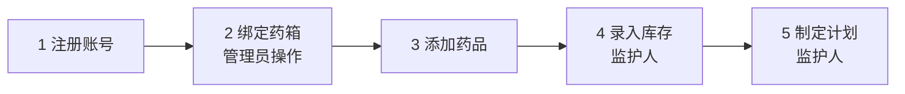
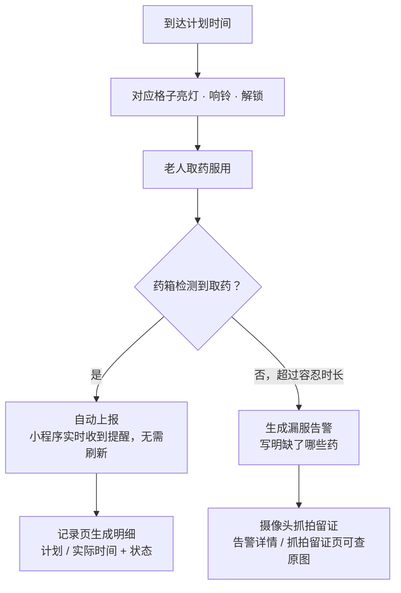
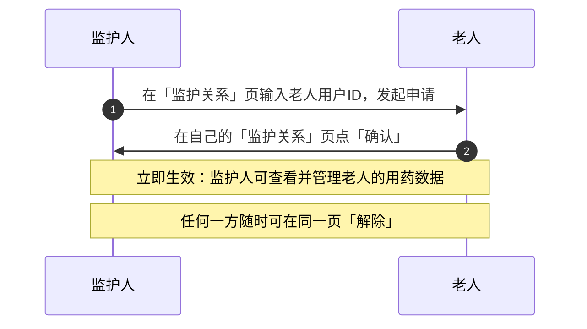
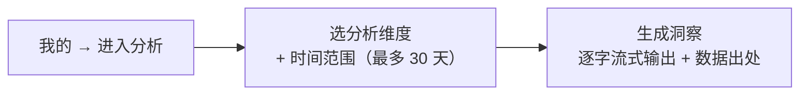

# 智能药箱 · 产品使用说明

> 写给**使用药箱的老人和帮忙照顾的家人**，不讲技术细节，只讲怎么用。
> 如果你是开发者，请看 [`medbox-spec/`](../medbox-spec/00_README_文档索引.md)。

---

## 一、这是一台什么样的药箱

药箱带**格子、灯和锁**：到点吃药，对应格子亮灯、响铃、解锁，老人拿药吃就行。家人用手机小程序远程安排一切——加药、定计划、看记录、收告警。

### 两种身份，各管一摊

| 身份 | 能做什么 |
|------|----------|
| **老人** | 看自己的计划、记录、设备、告警；确认家人的"监护申请" |
| **监护人**（子女 / 家人） | 替老人加药、录库存、定计划、处理告警、补录记录、配置 AI 分析 |

| 功能 | 老人 | 监护人 |
|------|:----:|:------:|
| 看计划 / 记录 / 设备 / 告警 | ✅（本人） | ✅（已绑定的老人） |
| 确认监护申请 | ✅ | — |
| 加药 · 录库存 · 定计划 | — | ✅ |
| 处理告警 · 补录纠错 | — | ✅ |
| 配置 AI Key · 周期洞察 | — | ✅ |

> ⚠️ 使用前提：手机和药箱要连在**同一个局域网**（同一台路由器 / 同一个家里网络）。提示"请检查手机与电脑是否在同一局域网"时，先检查 Wi-Fi。

---

## 二、开始使用（5 步）

### 第 1 步：注册账号

打开小程序 → **注册** → 填写 → 选身份 → 保存 → 回登录页登录。

| 要填的 | 要求 |
|--------|------|
| 手机号 | 11 位 |
| 密码 | 至少 6 位，需确认一遍 |
| 姓名 | 可不填 |
| 身份 | 二选一（见下表） |

| 选的身份 | 之后能做什么 |
|----------|--------------|
| **我是老人** | 查看自己的服药计划 |
| **我是监护人** | 代管老人的药品与计划 |

> 老人不会用手机？监护人可先代注册一个"老人"账号，再按第四节完成监护绑定。

### 第 2 步：绑定药箱（管理员操作）

药箱**不需要**在小程序里申请：管理员在后台审核准入后，设备自动归属到对应老人名下。在 **设备** 页可以看到：

| 能看到 | 内容 |
|--------|------|
| 设备清单 | 药箱主控 + 温度 / 湿度 / 光照 / 摄像头等传感器 |
| 运行状态 | 每台设备的 **在线 / 离线** + 最近心跳时间 |

> 看不到设备？请联系管理员确认设备已准入并分配给这位老人。

### 第 3 步：添加药品

**药品** 页 → 新建 → 填 **名称**、规格等信息 → 保存。

| 药品类型 | 谁能用 |
|----------|--------|
| 公共药品 | 全家通用 |
| 私有药品 | 只属于这位老人 |

### 第 4 步：录入库存（仅监护人）

入口：**设备详情 → 药箱库存**

| 操作 | 什么时候用 | 填什么 |
|------|------------|--------|
| **录入库存** | 首次录入 | 药品、数量（当前库存绝对值）、生产日期、有效期至 |
| **补药入库** | 买药回家加量 | 增量，日期可顺带更新 |
| **移除库存** | 药被拿走了 | 减少数量 |

> - 有效期只是记录，系统**不会**在过期时报警，需要家人自己留意更换。
> - 库存低于提醒线时，会提醒监护人补药。

### 第 5 步：制定服药计划（仅监护人）

入口：**计划** 页 → 新建计划

| 填写项 | 说明 |
|--------|------|
| 方案名称 | 如"早餐后""睡前" |
| 提醒时间 | 点 **＋ 添加时间**；按**药箱本地时间（默认北京时间）** |
| 重复周期 | 每天 / 每周 |
| 药品 | 点 **＋ 添加药品**，可多选，至少一种；**没有库存的药加不进去**（先做第 4 步） |

保存后，设备会按时间升序自动收到这份计划。

---

## 三、到点吃药是什么流程

- **每个时间段只提醒一次**，已服过的不重复响。
- **记录** 页看每一条服药明细；**依从性报告** 看按时率和漏服统计。

### 漏服"容忍时长"怎么定

从宽到严，三级优先：

| 优先级 | 来源 | 在哪里设 | 说明 |
|:---:|------|----------|------|
| 1（最高） | 计划级 | 单独的计划里 | 这个计划单独设的容忍分钟数 |
| 2 | 老人级 | 告警 → 告警设置 → "漏服容忍（分钟，老人级）" | 对该老人统一生效 |
| 3（兜底） | 系统默认 | — | 15 分钟 |

**提醒可以提前**：

| 设置项 | 位置 | 默认 |
|--------|------|------|
| 服药提醒提前期（分钟） | 告警 → 告警设置 | 提前 10 分钟 |

> 设备离线时不会做漏服判定，避免误报；断网期间数据离线缓存，联网后自动补传。

---

## 四、看护家人：监护关系

监护人想看老人的数据，需要老人**确认**一次：

| 要找的东西 | 位置 |
|------------|------|
| 老人的用户ID | 老人小程序 **我的** 页（"把用户ID xxx 告诉监护人…"） |

> - 老人没确认之前，监护人**访问不了**老人数据。
> - 老人自己只能看本人数据，无法代管别人。

---

## 五、告警与环境监测

| 告警类型 | 什么时候触发 | 提醒方式 |
|----------|--------------|----------|
| **漏服** | 到点没取药，超过容忍时长 | 消息写明缺哪些药（例："08:00 计划服药未按时服用：缺 阿莫西林、维生素D"）；同时抓拍留证 |
| **环境** | 温度 / 湿度 / 光照超出阈值 | 数值恢复正常**不发**恢复通知；同一指标短时间内不重复告警 |

**告警页**：按类型（漏服 / 环境）和已读 / 未读筛选，看完可标记处理；首页显示"N 条未读"。

**告警设置**常用项：

| 设置项 | 位置 | 作用 | 默认 |
|--------|------|------|------|
| 漏服容忍（分钟，老人级） | 告警设置 | 老人级漏服判定 | 15 |
| 服药提醒提前期（分钟） | 告警设置 | 提前多久提醒 | 10 |
| 环境阈值 | 告警设置 | 温度（℃）/ 湿度（%）/ 光照（lux）上下限 | 需自行设置 |

**环境监测页**：看温度 / 湿度 / 光照的历史曲线。

---

## 六、AI 健康洞察

这是一份"自动生成的用药分析报告"，不是聊天问答：

| 项目 | 说明 |
|------|------|
| 形式 | 自动生成的用药分析报告（不是聊天问答） |
| 谁能看 | 老人本人；监护人可代为查看 |
| 需要什么 | 监护人配置的大模型 API Key（未配置无法生成） |
| 监护人额外能力 | 开启 **周期洞察（自动推送）**；配置 AI Key（老人端看不到 Key） |

> ⚠️ 免责声明：AI 分析仅供参考，**用药与设备调整请由监护人 / 医生决策**。

---

## 七、记录补录与纠错（监护人）

设备偶尔会漏报。监护人在 **记录** 页对某条计划做修正，让依从性报告保持准确：

| 场景 | 做法 |
|------|------|
| 设备漏报了这次服药 | 对某条计划 **手动补录** |
| 其实吃了，但记录错了 | **纠错** |

---

## 八、常见问题 FAQ

| 你遇到的 | 先检查 / 答案 |
|----------|---------------|
| 手机上一直收不到提醒 | ① 手机和药箱是否同一局域网；② 设备页里药箱是否"在线"；③ 是否已登录且身份正确。到点声光提醒由药箱**本地执行**，不依赖手机在线。 |
| 加了计划但药箱不响 | ① 计划里的每种药都有库存；② 时间填的是药箱本地时间（默认北京时间）；③ 设备在线且已收到计划（设备事件页看上报记录）。 |
| 监护人看不到老人的数据 | 监护关系还没生效，请老人在自己的"监护关系"页点 **确认**。 |
| 药快到期了会提醒吗 | 不会。有效期仅作记录，系统不做过期预警，请家人自行留意。 |
| 漏服了，其实是老人吃了没放回 | 监护人可在记录页 **手动补录 / 纠错**。 |
| 忘了密码 / 不想用了 | **我的** 页可退出登录、注销账号（注销不可撤销）。 |
| 能在家里 Wi-Fi 之外用吗 | 不能。目前整套系统运行在局域网内，出门在外无法访问；远程能力属后续规划。 |
| 有紧急求助 / 远程看摄像头吗 | 本期没有。未取药会抓拍留证，但无实时画面、无紧急呼叫功能。 |

---

## 九、页面速查表

| 想做什么 | 去哪里 |
|----------|--------|
| 看药箱在线状态 | 首页 → 我的设备 / 底部 **设备** Tab |
| 加一种新药 | 首页 → 药品管理 |
| 补药 / 查库存 | 设备详情 → 药箱库存 |
| 定吃药时间 | 首页 → 服药计划 |
| 看吃了没有 | 首页 → 服药记录 → 依从性报告 |
| 处理漏服提醒 | 首页 → 告警 |
| 调提醒提前量 / 容忍时长 / 温湿度阈值 | 告警 → 告警设置 |
| 绑定 / 解除家人监护 | 首页 → 监护关系 |
| 生成 AI 用药分析 | 我的 → 进入分析 |
| 退出 / 注销 | 我的 |
