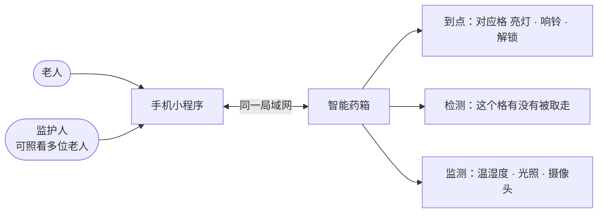
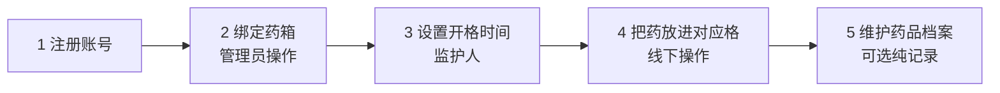
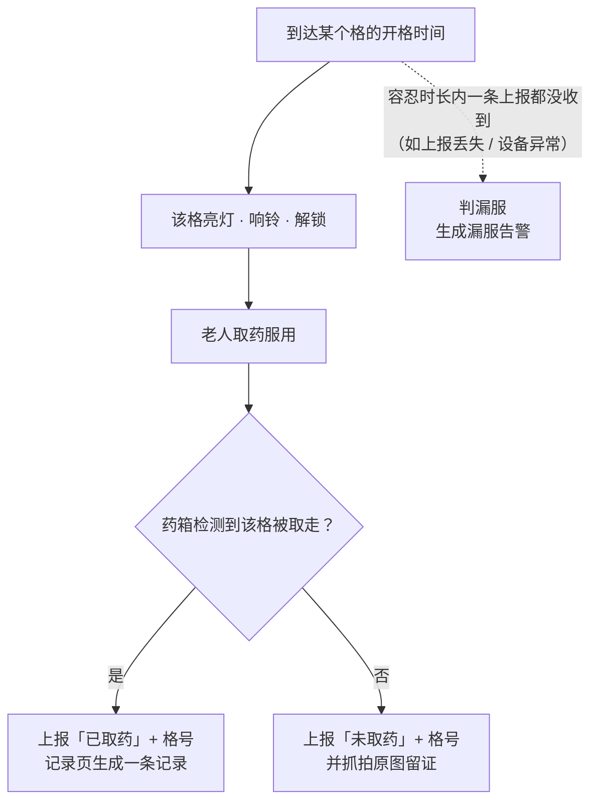
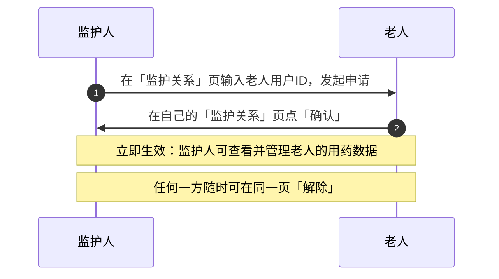
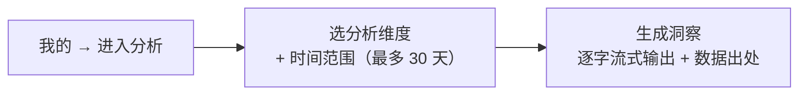

# 智能药箱 · 产品使用说明

> 写给**使用药箱的老人和帮忙照顾的家人**，不讲技术细节，只讲怎么用。
> 如果你是开发者，请看 [`medbox-spec/`](../medbox-spec/00_README_文档索引.md)。

---

## 一、这是一台什么样的药箱

药箱上层有 **3 个固定编号的带锁药格**：**1 号格对应早上、2 号格对应中午、3 号格对应晚上**。到点后，对应格子**亮灯、响铃、解锁**，老人拿药服用即可。

家人用手机小程序安排的是 **“几点开几号格”**，并查看记录、接收告警。

### 三个药格怎么分工

| 格号 | 固定对应 | 排了开格时间 | 没排时间 |
|:---:|:---:|------|------|
| **1 号格** | 早间 | 到点亮灯、响铃、解锁 | 该格不提醒、不解锁 |
| **2 号格** | 午间 | 到点亮灯、响铃、解锁 | 该格不提醒、不解锁 |
| **3 号格** | 晚间 | 到点亮灯、响铃、解锁 | 该格不提醒、不解锁 |

> **格子里放什么药，系统不记录、也不检查。** 由家人自己把早 / 中 / 晚要吃的药分别放进 1 / 2 / 3 号格，同一格可以放多种药。
> 小程序里的**药品档案是另一本纯记录**，只用于记录和查看"有哪些药"，**和格位、药箱都没有绑定关系**。

### 两种身份，各管一摊

| 身份 | 能做什么 |
|------|----------|
| **老人** | 看自己的计划、记录、设备、告警；确认家人的“监护申请” |
| **监护人**（子女 / 家人） | 布置药格、设置开格时间、维护药品档案、处理告警、补录记录、配置 AI 分析 |

| 功能 | 老人 | 监护人 |
|------|:----:|:------:|
| 看计划 / 记录 / 设备 / 告警 | ✅（本人） | ✅（已绑定的老人） |
| 确认监护申请 | ✅ | — |
| 设置“几点开几号格” | — | ✅ |
| 把药放进格子（线下） | ✅ | ✅ |
| 维护药品档案（纯记录） | — | ✅ |
| 处理告警 · 补录纠错 | — | ✅ |
| 配置 AI Key · 周期洞察 | — | ✅ |

> ⚠️ 使用前提：手机和药箱要连在**同一个局域网**（同一台路由器 / 同一个家里网络）。提示“请检查手机与电脑是否在同一局域网”时，先检查 Wi-Fi。

---

## 二、开始使用（5 步）

### 第 1 步：注册账号

打开小程序 → **注册** → 填写 → 选身份 → 保存 → 回登录页登录。

| 要填的 | 要求 |
|--------|------|
| 手机号 | 11 位 |
| 密码 | 至少 6 位，需确认一遍 |
| 姓名 | 可不填 |
| 身份 | 二选一（见下表） |

| 选的身份 | 之后能做什么 |
|----------|--------------|
| **我是老人** | 查看自己的开格时间、服药记录、设备与告警 |
| **我是监护人** | 代管老人的药格排程、药品档案、告警 |

> 老人不会用手机？监护人可先代注册一个“老人”账号，再按第四节完成监护绑定。

### 第 2 步：绑定药箱（管理员操作）

药箱**不需要**在小程序里申请：管理员在后台审核准入后，设备自动归属到对应老人名下。在 **设备** 页可以看到：

| 能看到 | 内容 |
|--------|------|
| 设备清单 | 药箱主控 + 温度 / 湿度 / 光照 / 摄像头等传感器 |
| 运行状态 | 每台设备的 **在线 / 离线** + 最近心跳时间 |

> 看不到设备？请联系管理员确认设备已准入并分配给这位老人。

### 第 3 步：设置开格时间（仅监护人）

入口：**计划** 页 → 新建计划（如果已有计划，直接点计划卡片编辑）

| 填写项 | 说明 |
|--------|------|
| 方案名称 | 选填，如“日常服药” |
| **1 号格（早间）** | 打开开关，选择开格时间（如 08:00） |
| **2 号格（午间）** | 打开开关，选择开格时间（如 12:30） |
| **3 号格（晚间）** | 打开开关，选择开格时间（如 18:00） |
| 重复周期 | 每天（本期只有“每天”） |

要点：

- **至少打开一个格并设置有效时间**才能保存；一个格只能设一个时间。
- 不用的格直接关掉：该格当天**不提醒、不解锁**。
- 时间填的是**药箱本地时间**（默认北京时间），不是手机所在地时间。
- **计划里不选药**——格内放什么药由家人自己布置，药品档案只是独立记录。
- 每位老人**只有一份计划**；改时间直接编辑保存，不需要也不能再新建第二份。
- 保存后计划会自动同步给药箱；计划卡片上会显示 **待同步 / 已同步 / 同步失败**。

### 第 4 步：把药放进对应格（线下操作）

| 做法 | 说明 |
|------|------|
| 按次分格 | 早 / 中 / 晚要吃的药，分别放进 1 / 2 / 3 号格 |
| 同格多药 | 同一格可以放当次要吃的多种药，自己分好即可 |
| 没排程的格 | 到点不会打开，可以不放药 |
| 系统不校验 | 系统只认“格号 + 时间”，不知道、也不会检查格内放了什么 |

> 建议每天固定时间补放或检查一次，避免放错格、漏放药。

### 第 5 步：维护药品档案（可选记录，仅监护人）

**药品** 页 → 新建 → 填 **名称**、规格等信息 → 保存。

| 药品类型 | 谁能用 |
|----------|--------|
| 公共药品 | 全体用户可见（只读） |
| 私有药品 | 只属于这位老人 |

> - 药品档案是**纯手工记录**：只记"有哪些药"（名称 / 规格 / 用法 / 禁忌等文字信息），**不记数量、不记生产日期和有效期**。
> - 药品档案**与药箱、格位无关**：设备不读取药品档案，服药 / 补录 / 纠错也**不会**改动它，与放药位置没有对应关系。

---

## 三、到点吃药是什么流程

- **每个格每个时间点只提醒一次**，已处理过的不重复响。
- **记录** 页按“格位”看明细：计划时间、实际时间、已取药 / 未取药、按时 / 未按时。
- 药箱上报“未取药”时，会生成一条带抓拍图的记录，可在记录详情里回看留证。
- 若容忍时长内**完全没收到上报**（例如上报丢失或设备异常），才判漏服并生成告警。
- **依从性报告** 看按时率、漏服、迟到与未判定统计。

### 漏服“容忍时长”怎么定

从宽到严，三级优先：

| 优先级 | 来源 | 在哪里设 | 说明 |
|:---:|------|----------|------|
| 1（最高） | 计划级 | 单独的计划里 | 这个计划单独设的容忍分钟数 |
| 2 | 老人级 | 首页 → 监护台 → 告警设置 → “漏服容忍（分钟，老人级）” | 对该老人统一生效 |
| 3（兜底） | 系统默认 | — | 15 分钟 |

> 计划级容忍目前小程序未开放编辑，实际按老人级或系统默认生效。

**提醒可以提前**：

| 设置项 | 位置 | 默认 |
|--------|------|------|
| 服药提醒提前期（分钟） | 首页 → 监护台 → 告警设置 | 提前 10 分钟 |

> 设备离线时默认不判漏服，避免“上报不了 = 漏服”的误报；断网期间数据离线缓存，联网后自动补传。

---

## 四、看护家人：监护关系

监护人想看老人的数据，需要老人**确认**一次：

| 要找的东西 | 位置 |
|------------|------|
| 老人的用户ID | 老人小程序 **我的** 页（“把用户ID xxx 告诉监护人…”） |

> - 老人没确认之前，监护人**访问不了**老人数据。
> - 老人自己只能看本人数据，无法代管别人。

---

## 五、告警与环境监测

| 告警类型 | 什么时候触发 | 提醒方式 |
|----------|--------------|----------|
| **漏服** | 到点后该格超过容忍时长，**一条上报都没收到** | 消息只写“几点、几号格”，如“08:00 1 号格（早间）未按时取药”；**不提药品名** |
| **环境** | 温度 / 湿度 / 光照超出阈值 | 数值恢复正常**不发**恢复通知；同一指标短时间内不重复告警 |

> 药箱已经上报“未取药”的，会落在记录里并附抓拍图，不重复生成漏服告警。系统不知道格内放了什么药，所以告警只按格号与时间提醒。

**告警页**：按类型（漏服 / 环境）和已读 / 未读筛选，看完可标记已读或处理；详情里会显示对应**格位**；首页显示“N 条未读”。

**告警设置**常用项：

| 设置项 | 位置 | 作用 | 默认 |
|--------|------|------|------|
| 漏服容忍（分钟，老人级） | 首页 → 监护台 → 告警设置 | 老人级漏服判定 | 15 |
| 服药提醒提前期（分钟） | 首页 → 监护台 → 告警设置 | 提前多久提醒 | 10 |
| 环境阈值 | 首页 → 监护台 → 告警设置 | 温度（℃）/ 湿度（%）/ 光照（lux）上下限 | 需自行设置 |

**环境监测页**：看温度 / 湿度 / 光照的历史曲线。

---

## 六、AI 健康洞察

这是一份“自动生成的用药分析报告”，不是聊天问答：

| 维度 | 看什么 |
|------|--------|
| 漏服分析 | 哪些时段容易漏服、是否需要加强提醒 |
| 环境关联 | 温湿度异常与当时段用药情况的关联 |
| 趋势预警 | 漏服与告警的历史趋势 |
| 综合洞察 | 以上全部（默认） |

| 项目 | 说明 |
|------|------|
| 形式 | 自动生成的用药分析报告（不是聊天问答） |
| 谁能看 | 老人本人；监护人可代为查看 |
| 需要什么 | 监护人配置的大模型 API Key（未配置无法生成） |
| 监护人额外能力 | 开启 **周期洞察（自动推送）**；配置 AI Key（老人端看不到 Key） |

> ⚠️ 免责声明：AI 分析仅供参考，**用药与设备调整请由监护人 / 医生决策**。

---

## 七、记录补录与纠错（监护人）

设备偶尔会漏报。监护人在 **记录** 页对某条记录做修正，让依从性报告保持准确：

| 场景 | 做法 |
|------|------|
| 设备漏报了这次服药 | **补录新记录**：选择计划、格号（1 / 2 / 3），标记已取药 / 未取药 |
| 其实吃了，但记录错了 | **纠错**：只改取药结论，不改计划时间 |

> 补录和纠错只改服药记录本身，**不改动药品档案**。

---

## 八、常见问题 FAQ

| 你遇到的 | 先检查 / 答案 |
|----------|---------------|
| 手机上一直收不到提醒 | ① 手机和药箱是否同一局域网；② 设备页里药箱是否“在线”；③ 是否已登录且身份正确。到点声光提醒由药箱**本地执行**，不依赖手机在线。 |
| 加了计划但药箱不响 | ① 对应格是否已打开并设置有效时间；② 时间是否是药箱本地时间（默认北京时间）；③ 设备是否在线、计划卡片是否显示“同步失败”（失败可重新保存一次）。 |
| 计划里为什么选不了药 | 现在的计划只排“几点开几号格”，**不绑定药品**；请把药直接放进对应格。 |
| 放错格了系统会发现吗 | 不会。系统按格号开关，不识别格内药品，请家人自己核对。 |
| 库存会自动扣吗 | 系统**没有库存功能**：药品档案只记"有哪些药"，不记数量，服药、补录、纠错都不会增减任何数字。 |
| 药快到期了会提醒吗 | 不会。药品档案不记录有效期，系统没有过期预警。 |
| 漏服了，其实是老人吃了没放回 | 监护人可在记录页 **补录 / 纠错**（选计划 + 格号 + 已取药）。 |
| 告警为什么只写几号格，不写药名 | 系统不记录格内放了什么药，只能按格号与时间提醒；看记录和抓拍图即可核对。 |
| 忘了密码 / 不想用了 | **我的** 页可退出登录、注销账号（注销不可撤销）。 |
| 能在家里 Wi-Fi 之外用吗 | 不能。目前整套系统运行在局域网内，出门在外无法访问；远程能力属后续规划。 |
| 有紧急求助 / 远程看摄像头吗 | 本期没有。未取药会抓拍留证，但无实时画面、无紧急呼叫功能。 |

---

## 九、页面速查表

| 想做什么 | 去哪里 |
|----------|--------|
| 看药箱在线状态 | 首页 → 我的设备 / 底部 **设备** Tab |
| 设置几点开几号格 | 首页 → 服药计划 |
| 把药放进格子 / 检查格内药 | 线下直接操作（系统不记录） |
| 加一种新药 | 首页 → 药品管理（纯记录） |
| 看吃了没有 | 首页 → 服药记录（按格）→ 依从性报告 |
| 处理漏服提醒 | 首页 → 告警 |
| 调提醒提前量 / 容忍时长 / 温湿度阈值 | 首页 → 监护台 → 告警设置 |
| 绑定 / 解除家人监护 | 首页 → 监护关系 |
| 生成 AI 用药分析 | 我的 → 进入分析 |
| 退出 / 注销 | 我的 |
