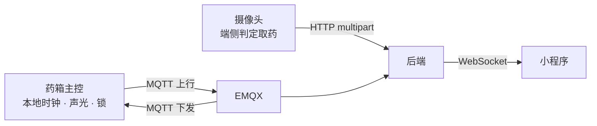

# 单片机与摄像头联调对接说明（药箱 ↔ 后端）

> 适用对象：药箱主控（单片机）、摄像头固件、后端联调人员。
> 协议契约以 [`medbox-spec/02b_设备管理.md`](../medbox-spec/02b_设备管理.md) 和 [`medbox-spec/03_设备接入协议_MQTT.md`](../medbox-spec/03_设备接入协议_MQTT.md) 为准；本文是双方共用的**准备步骤 + 参数确认单 + 验收清单**。

---

## 0. 链路总览



| 角色             | 负责                                                                   | 不负责                                          |
| ---------------- | ---------------------------------------------------------------------- | ----------------------------------------------- |
| **单片机** | 本地时钟、计划持久化、到点声光与解锁、遥测 / 心跳 / 异常上报、回执 ack | 服药事件上报（由摄像头做）、运行图像识别        |
| **摄像头** | 端侧判定该格是否被取走，HTTP 直连后端上报 **格号 + 取药结论**           | 经 MQTT 上报、经单片机中转                      |
| **后端**   | 登记设备、下发「时间 → 格号」排程、判漏服、统计、告警                   | 下发实时声光 / 解锁指令、记录格内药品、运行图像识别 |
| **小程序** | 配置格位排程 / 查看按格记录与告警                                      | 驱动设备                                        |

> 三条关键边界：**后端不下发实时提醒**（计划下发后设备本地闭环）；**服药事件不走 MQTT**（摄像头 HTTP 直报）；**后端只建模「格号 + 时间」**（格号 1 / 2 / 3 由固件固定对应早 / 中 / 晚，后端不记录、不校验格内放什么药）。

---

## 1. 联调前准备（后端侧执行）

### 1.1 环境检查

- [ ] PostgreSQL 已启动，后端能正常启动（Flyway 自动建表）
- [ ] EMQX 已启动，`localhost:1883` 可连
- [ ] 后端端口 `8080`、context-path `/medbox`
- [ ] 局域网内其它机器能访问：`http://<后端内网IP>:8080/medbox/api/v1`

```bash
BASE=http://localhost:8080/medbox/api/v1
# 局域网联调时换成：BASE=http://<后端内网IP>:8080/medbox/api/v1
```

### 1.2 方式 A：测试数据一键播种（仅前端 / 后端联调）

需要后端以 `medbox.devtools.enabled=true` 启动（默认关闭）：

```bash
MEDBOX_DEVTOOLS_ENABLED=true ./gradlew bootRun
curl -s -X POST "$BASE/_debug/seed?reset=true" | jq
```

播种内容：监护人 `u-debug-guardian`（`13800001234 / 123456`）、老人 `e-1001`（`13800008888 / 123456`）、ACTIVE 监护关系、主控 `BOXA-DEBUG-01` + 3 个传感器、药品目录 / 库存台账 / **单格排程计划**（只排 1 号格，开格时间 = 播种时刻 +2 分钟）。

```bash
TOKEN=$(curl -s -X POST "$BASE/_debug/seed" | jq -r '.data.guardianToken')
```

> ⚠️ `BOXA-DEBUG-01` 是种子专用编号，`reset=true` 会按它删设备。**真机不能复用，请新建设备**。

### 1.3 方式 B：真机正式登记

**第 1 步：登录拿监护人 token**

```bash
TOKEN=$(curl -s -X POST "$BASE/auth/login" \
  -H 'Content-Type: application/json' \
  -d '{"account":"13800001234","password":"123456"}' | jq -r '.data.token')
```

**第 2 步：确认监护关系为 ACTIVE**（种子账户已就绪，手动注册的账户才需要）

```bash
# 监护人发起
curl -s -X POST "$BASE/users/<elderId>/guardians" \
  -H "Authorization: Bearer $TOKEN" | jq

# 老人登录后查待确认，拿到 relationId
ETOKEN=$(curl -s -X POST "$BASE/auth/login" -H 'Content-Type: application/json' \
  -d '{"account":"<老人手机号>","password":"<密码>"}' | jq -r '.data.token')
curl -s -H "Authorization: Bearer $ETOKEN" "$BASE/users/guardians/pending" | jq

# 老人确认
curl -s -X PATCH "$BASE/users/guardians/<relationId>/accept" \
  -H "Authorization: Bearer $ETOKEN" -H 'Content-Type: application/json' -d '{}' | jq
```

**第 3 步：登记主控 + 传感器**（必须用监护人 token）

```bash
curl -s -X POST "$BASE/devices/register" \
  -H "Authorization: Bearer $TOKEN" \
  -H 'Content-Type: application/json' \
  -d '{
    "deviceId": "BOXA1001",
    "elderId": "e-1001",
    "productKey": "medbox-box",
    "timezone": "Asia/Shanghai",
    "sensors": [
      { "deviceId": "BOXA1001-S-TH01",  "deviceType": "TEMP_HUMI" },
      { "deviceId": "BOXA1001-S-LX01",  "deviceType": "LIGHT" },
      { "deviceId": "BOXA1001-S-CAM01", "deviceType": "CAMERA" }
    ]
  }' | jq
```

**第 4 步：验证**

```bash
curl -s -H "Authorization: Bearer $TOKEN" "$BASE/devices" | jq
curl -s -H "Authorization: Bearer $TOKEN" "$BASE/devices/BOXA1001" | jq
```

预期：列表出现 `BOXA1001`，`onlineState=OFFLINE`；详情里能看到 3 个子设备。

**登记规则（必须提前知道）**

| 情况                                  | 结果                                                           |
| ------------------------------------- | -------------------------------------------------------------- |
| 老人 token 调 register                | 40301                                                          |
| 监护关系仍为 PENDING                  | 40302                                                          |
| 编号已存在（含子设备）                | 40901，不覆盖、不改绑                                          |
| 改 deviceId / productKey / 子设备编号 | 本期**没有解绑或编辑接口**，只能换新编号重新登记，或清库 |
| 设备未登记就发 MQTT                   | 消息被静默丢弃（仅 DEBUG 日志），表现为"永远离线"              |

> 设备编号必须在登记前定死；登记完成即代表这台机器的身份。

---

## 2. 联调设备信息确认单

> 双方逐项确认后签字。任一"身份"项改动都需要重新登记设备。

### 2.1 身份（定死后不可改）

| 项            | 取值                 | 说明                                |
| ------------- | -------------------- | ----------------------------------- |
| 主控 deviceId | `BOXA1001`         | 4~64 位 `[A-Za-z0-9_-]`，全库唯一 |
| 温湿传感器 id | `BOXA1001-S-TH01`  | 上报 `temperature` / `humidity` |
| 光照传感器 id | `BOXA1001-S-LX01`  | 上报 `lux`                        |
| 摄像头 id     | `BOXA1001-S-CAM01` | 抓拍时用它自己的 id                 |
| productKey    | `medbox-box`       | topic 第 2 层                       |
| 时区          | `Asia/Shanghai`    | 计划时间按此墙钟                    |
| msgId 前缀    | `BOXA1001-`        | 后接 10 位递增序号，掉电不归零      |
| MQTT clientId | `BOXA1001`         | **必须等于 deviceId**         |
| 药格编号      | `1` / `2` / `3`    | **固件固定对应早 / 中 / 晚**，不可配置；后端只按格号下发时间 |

### 2.2 连接参数

| 项                        | 取值                                                                        | 状态    |
| ------------------------- | --------------------------------------------------------------------------- | ------- |
| MQTT Broker               | `tcp://<EMQX内网IP>:1883`                                                 | 待填 IP |
| MQTT 认证                 | 本期匿名，无用户名密码                                                      | 固定    |
| 加密                      | 明文，无 TLS                                                                | 固定    |
| 后端 HTTP                 | `http://<后端内网IP>:8080/medbox/api/v1`                                  | 待填 IP |
| Wi-Fi SSID / 密码         | `____________`                                                            | 待填    |
| 设备 IP                   | DHCP 静态保留 `____________`                                              | 待填    |
| KeepAlive                 | 60s                                                                         | 固定    |
| 遗嘱 LWT                  | topic `medbox/medbox-box/BOXA1001/status`，`{"online":false}`，retained | 固定    |
| 上线消息                  | 同 topic，`{"online":true}`，retained                                     | 固定    |
| QoS                       | 遥测 0/1、心跳 0、异常 1、ack 1、下行 1                                     | 固定    |
| MQTT 版本 / clean session | `____________`                                                            | 待确认（影响设备离线时下行能否补收） |

### 2.3 Topic 与报文

| 方向 | Topic                                              | 内容                                                                                          |
| ---- | -------------------------------------------------- | --------------------------------------------------------------------------------------------- |
| 上行 | `medbox/medbox-box/BOXA1001/up/telemetry`        | `{msgId, ts, sensorId, temperature, humidity}` 或 `{..., lux}`，每个传感器各一条          |
| 上行 | `medbox/medbox-box/BOXA1001/up/sensor/heartbeat` | `{msgId, ts, sensors:[{sensorId, online}, ...]}`，60s 一次                                  |
| 上行 | `medbox/medbox-box/BOXA1001/up/event/error`      | `{msgId, ts, type, detail}`，`type` = `DOOR_TIMEOUT` / `CAMERA_FAILED` / `HW_FAULT` |
| 上行 | `medbox/medbox-box/BOXA1001/up/ack`              | `{msgId, ts, ackFor, result:"OK"/"FAILED", reason}`                                         |
| 下行 | `medbox/medbox-box/BOXA1001/down/schedule`       | `{msgId, planId, op:"UPSERT"/"DELETE", slots:[{cellNo,time}], repeat, alarm:{missAfterMin}, needAck}` |
| 下行 | `medbox/medbox-box/BOXA1001/down/command`        | `{msgId, cmd:"REBOOT"/"CALIBRATE", params, needAck}`                                        |

- [ ] 所有上行必须带 `msgId`，缺了会被后端直接丢弃
- [ ] `msgId` 序号**持久化**，重启不归零
- [ ] 下行消息 `needAck:true` 时必须回 `up/ack`；5s 未回后端重发，3 次后判失败
- [ ] `down/schedule` 必须**本地持久化**，重启后继续生效
- [ ] `slots[].time` 是**设备本地墙钟时间**（`HH:mm`），不是 UTC；`slots[].cellNo` 取 1 / 2 / 3
- [ ] **缺失的格号 = 该格当天不排程**（不提醒、不解锁）；后端不下发药品、剂量
- [ ] 保存计划后后端**立即下行一次**，不判断设备在线；下行 QoS1 且 `retained=false`，设备离线时能否补收取决于 broker 会话（`clean session=false` 才保留）——**联调时先上线再保存计划**
- [ ] 后端**不下发**蜂鸣（`BUZZ`）与开格（`UNLOCK`），由设备本地或小程序本地触发

### 2.4 摄像头抓拍（HTTP 直连后端）

| 项                | 取值                                                                                                                    |
| ----------------- | ----------------------------------------------------------------------------------------------------------------------- |
| 端点              | `POST /devices/BOXA1001-S-CAM01/captures`                                                                             |
| `X-Device-Id`   | `BOXA1001-S-CAM01`（必须与路径一致）                                                                                  |
| `X-Timestamp`   | Unix 秒，与服务器偏差 ≤ 5 分钟                                                                                         |
| `X-Device-Sign` | `HMAC_SHA256(secret, deviceId + timestamp)`，小写十六进制                                                             |
| 共用密钥          | `____________`（与后端 `MEDBOX_CAPTURE_UPLOAD_SECRET` 一致，线下交付，不入库不进仓库）                              |
| 表单字段          | `cellNo`（1/2/3，`planId` 非空时必带）、`takenResult`、`planId`、`capturedAt`（ISO-8601 UTC）、`reason` |
| 图片              | `TAKEN` **不带图**；`UNTAKEN` **必须带 `file`**；单文件 ≤ 10MB                                       |
| 去重              | 同一 `planId + cellNo` 60s 内重复只保留第一张；同一计划同一格同一时间槽只落一条记录                   |

### 2.5 待拍板事项

> 格位语义已定：固件固定 **1 / 2 / 3 = 早 / 中 / 晚**；后端只下发「格号 + 时间」，不关心、不记录格内放什么药。

1. 单片机是否带 RTC、是否 NTP 校时。
2. deviceId 的烧录方式（源码常量 / NVS / 串口写入）。
3. 摄像头是独立联网还是挂主控（协议只约束"摄像头 → 后端"这一跳 HTTP）。
4. 匿名 MQTT 是否仅用于局域网演示（后续是否加 EMQX ACL）。
5. MQTT 协议版本与 clean session 取值。

---

## 3. 设备侧实现清单

### 3.1 连接

- [ ] clientId = deviceId
- [ ] 上线发布 retained `{"online":true}`，设置 LWT `{"online":false}`（retained）
- [ ] KeepAlive 60s
- [ ] 断线重连后重新订阅下行 topic
- [ ] 订阅 `medbox/medbox-box/BOXA1001/down/#`

### 3.2 上行

- [ ] 温湿遥测：`temperature` / `humidity`，`sensorId=BOXA1001-S-TH01`
- [ ] 光照遥测：`lux`，`sensorId=BOXA1001-S-LX01`
- [ ] 传感器心跳：每 60s 汇总所有子设备 `online` 状态
- [ ] 异常事件：门超时 / 摄像头失败 / 硬件故障
- [ ] 断网缓存、联网补传
- [ ] 所有报文带持久化递增 `msgId`

### 3.3 下行

- [ ] 解析 `down/schedule` 的 `UPSERT` / `DELETE`
- [ ] 计划落本地存储，重启不丢
- [ ] 按 `slots` 的 `cellNo` 到点对该格声光 + 解锁；未出现的格号不动作
- [ ] 解析 `down/command` 的 `REBOOT` / `CALIBRATE`
- [ ] 处理后回 `up/ack`（`ackFor` = 下行 msgId）

### 3.4 摄像头

- [ ] 取药结论端侧判定为二值 `TAKEN` / `UNTAKEN`
- [ ] 上报**格号 `cellNo`（1/2/3）**；`planId` 非空时 `cellNo` 必带，缺失 / 越界会被 40001 拒绝
- [ ] HTTP multipart 直报后端，不经 MQTT、不经单片机
- [ ] `UNTAKEN` 附原图，`TAKEN` 不附图
- [ ] 时间戳与服务器偏差 ≤ 5 分钟

---

## 4. 联调验收顺序

| 步骤 | 操作                | 期望结果                                                                                                |
| :--: | ------------------- | ------------------------------------------------------------------------------------------------------- |
|  1  | 后端登记设备        | `GET /devices` 能看到 `BOXA1001`，状态 OFFLINE                                                      |
|  2  | 设备连 EMQX         | 小程序设备页变 ONLINE，出现最近心跳                                                                     |
|  3  | 发一条温湿遥测      | 设备详情出现温湿度读数                                                                                  |
|  4  | 发传感器心跳        | 三个子设备分别显示在线 / 离线                                                                           |
|  5  | 保存 / 修改一次计划 | `mosquitto_sub -t 'medbox/#' -v` 能看到 `down/schedule`（载荷含 `slots`）；设备 ack 后计划状态变 `SYNCED_TO_DEVICE` |
|  6  | 下发命令            | 收到 `down/command`；ack 后命令变 `SUCCESS`                                                         |
|  7  | 到点取药            | 记录页出现 **已取药**，显示对应格号与按时 / 未按时                                                    |
|  8  | 到点不取药          | 记录页出现 **未取药** + 抓拍原图（UNTAKEN 必须带图）                                                  |
|  9  | 完全不上报超时      | 生成漏服告警，消息只写「时间 + 格号」（如「08:00 1 号格（早间）未按时取药」）                          |
| 10  | 断网再恢复          | 设备变离线；恢复后缓存数据补传，设备回到在线                                                            |

---

## 5. 排查手册

| 现象                                | 先查                                                                                                                   |
| ----------------------------------- | ---------------------------------------------------------------------------------------------------------------------- |
| 设备一直离线                        | ① 设备是否已登记；② clientId 是否等于 deviceId；③ EMQX 里是否真有这个连接                                           |
| 上行发了但没反应                    | ① 是否带 `msgId`；② msgId 是否重复（重启归零会命中旧记录）；③ topic 层级是否 `medbox/{pk}/{deviceId}/up/...`    |
| 下行收不到                          | ① 固件订阅的 productKey 是否与登记时一致（下行按数据库里的 productKey 发）；② 设备是否在线；③ 是否订阅了 `down/#` |
| 命令/计划一直不生效                 | ① 命令要求设备在线，离线时下发报 40901；② 计划保存时设备离线，下行可能已丢失（`retained=false`）；③ 计划是否已启用；重连后重新保存一次计划 |
| 到点该格不动作                      | ① 该 `cellNo` 是否在 `slots` 里（缺失即未排程）；② 计划是否已启用并 `SYNCED_TO_DEVICE`；③ 设备本地时钟是否正确 |
| 抓拍 40101                          | HMAC 签名算法、密钥、时间戳偏差 > 5 分钟                                                                               |
| 抓拍 40301                          | 摄像头未登记，或其父主控缺失                                                                                           |
| 抓拍 40001                          | `X-Device-Id` 与路径不一致；`planId` 非空时 `cellNo` 缺失 / 越界；`UNTAKEN` 没带 `file`                              |
| 设备页有数据但 `onlineState` 不对 | 设备没发 retained 上线消息，但任意上行也能刷新在线态                                                                   |

常用命令：

```bash
# 订阅所有下行
mosquitto_sub -h <EMQX_IP> -t 'medbox/#' -v

# 模拟设备上线
mosquitto_pub -h <EMQX_IP> -t 'medbox/medbox-box/BOXA1001/status' -m '{"online":true}' -r

# 模拟一条遥测
mosquitto_pub -h <EMQX_IP> -t 'medbox/medbox-box/BOXA1001/up/telemetry' \
  -m '{"msgId":"BOXA1001-0000000001","ts":1759474487000,"sensorId":"BOXA1001-S-TH01","temperature":24.6,"humidity":52.1}'
```

---

## 6. 附：完整报文示例

### 6.1 上行 · 遥测

```json
{ "msgId":"BOXA1001-0000000001", "ts":1759474487000,
  "sensorId":"BOXA1001-S-TH01", "temperature":24.6, "humidity":52.1 }
```

```json
{ "msgId":"BOXA1001-0000000002", "ts":1759474488000,
  "sensorId":"BOXA1001-S-LX01", "lux":120 }
```

### 6.2 上行 · 传感器心跳

```json
{ "msgId":"BOXA1001-0000000003", "ts":1759474540000,
  "sensors":[ { "sensorId":"BOXA1001-S-TH01","online":true },
              { "sensorId":"BOXA1001-S-LX01","online":true },
              { "sensorId":"BOXA1001-S-CAM01","online":false } ] }
```

### 6.3 上行 · 设备异常

```json
{ "msgId":"BOXA1001-0000000004", "ts":1759474512000,
  "type":"DOOR_TIMEOUT", "detail":"仓门开启超过 60s 未关闭" }
```

### 6.4 上行 · 回执

```json
{ "msgId":"BOXA1001-0000000005", "ts":1759474520000,
  "ackFor":"d-001", "result":"OK", "reason":null }
```

### 6.5 下行 · 同步计划

```json
{ "msgId":"d-001", "planId":"p-3301", "op":"UPSERT",
  "slots":[ { "cellNo":1, "time":"08:00" },
            { "cellNo":2, "time":"12:30" },
            { "cellNo":3, "time":"18:00" } ],
  "repeat":"DAILY",
  "alarm":{"missAfterMin":15},
  "needAck":true }
```

### 6.6 下行 · 控制命令

```json
{ "msgId":"d-102", "cmd":"REBOOT", "params":{}, "needAck":true }
```

### 6.7 摄像头抓拍（curl 自测）

```bash
TS=$(date +%s)
SIG=$(printf '%s' "BOXA1001-S-CAM01${TS}" \
  | openssl dgst -sha256 -hmac '<共用密钥>' -hex | awk '{print $NF}')

curl -s -X POST "$BASE/devices/BOXA1001-S-CAM01/captures" \
  -H "X-Device-Id: BOXA1001-S-CAM01" \
  -H "X-Device-Sign: $SIG" \
  -H "X-Timestamp: $TS" \
  -F reason=NORMAL \
  -F planId=p-3301 \
  -F cellNo=1 \
  -F takenResult=TAKEN \
  -F capturedAt=2026-11-12T08:00:30Z

# 未取药：把 takenResult 改为 UNTAKEN，并追加 -F file=@capture.jpg
```
