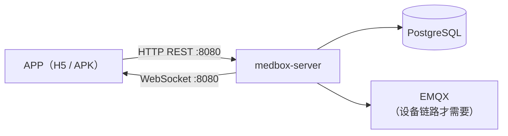

# APP 与后端 · 联调调试测试流程

> 适用对象：`medbox-app`（H5 本地联调 / Android APK 真机）↔ `medbox-server` 的开发者与 QA。
> 协议与字段口径以 [`medbox-spec/02`](../../medbox-spec/02_REST接口设计.md)、[`medbox-spec/04`](../../medbox-spec/04_实时推送协议_WebSocket.md) 为准；测试分层见 [`medbox-spec/08`](../../medbox-spec/08_测试体系与CI.md)。本文只讲**怎么起、怎么连、敲什么命令、怎么验收**。
> 约定：下面命令默认在**仓库根目录**执行；需要进子目录的会显式 `cd`。全部为局域网通信，无公网域名。

---

## 0. 链路与命令速查



| 目的 | 命令（仓库根目录） |
|------|------------------|
| 起依赖 | `cd medbox-server && docker compose up -d` |
| 起后端（开调试端点） | `cd medbox-server && MEDBOX_DEVTOOLS_ENABLED=true ./gradlew bootRun` |
| 健康检查 | `curl -s http://localhost:8080/medbox/actuator/health` |
| 一键播种（拿 token） | `curl -s -X POST "$BASE/_debug/seed?reset=true" \| jq` |
| 起 H5 客户端 | `cd medbox-app && npm run dev:h5` → <http://localhost:5173> |
| 客户端单测 | `cd medbox-app && npm test` |
| Mock 端到端 | `cd medbox-app && npm run test:e2e`（自起 18099，跑完即关） |
| 契约对 Mock | `cd medbox-app && npm run test:contract:mock` |
| 一键全跑 | `cd medbox-app && npm run test:all` |
| 后端单测 | `cd medbox-server && ./gradlew test` |

统一变量（每个 shell 先设一次）：

```bash
BASE=http://localhost:8080/medbox/api/v1
# 真机 / 局域网联调换成电脑内网 IP：
# BASE=http://192.168.1.23:8080/medbox/api/v1
```

---

## 1. 后端侧准备

### 1.1 PostgreSQL（只需一次）

```bash
cd medbox-server
docker compose up -d          # postgres:17，库 medbox / 账号 myuser / 密码 mypassword
docker compose down           # 停止，数据卷 medbox-pg-data 保留
```

若本机已有 `medbox-pg` 容器，只需建一次库：

```bash
docker exec -e PGPASSWORD=mypassword medbox-pg \
  psql -U myuser -d mydb -c "CREATE DATABASE medbox OWNER myuser;"
```

表由 Flyway 在应用启动时自动建。库连不上时 `actuator/health` 会显示 DOWN，起来后恢复 200。

### 1.2 起后端

```bash
cd medbox-server
MEDBOX_DEVTOOLS_ENABLED=true ./gradlew bootRun
```

- 环境变量 `MEDBOX_DEVTOOLS_ENABLED=true` 等价于 `medbox.devtools.enabled=true`，**必须重启才生效**（默认关闭，`_debug` 端点不装配，访问返回 `40401`）。
- 也可写进不入库的 `src/main/resources/application-local.yml`，再 `SPRING_PROFILES_ACTIVE=local ./gradlew bootRun`；模板见 `application-local.yml.example`。
- 只要调 APP 的 REST / WS，不连设备时可关 MQTT：`MEDBOX_MQTT_ENABLED=false ./gradlew bootRun`。
- 契约真后端双跑时要关登录限流，否则逐条登录会撞 `42901`：`MEDBOX_RATELIMIT_ENABLED=false ./gradlew bootRun`。

### 1.3 健康检查与播种

```bash
curl -s http://localhost:8080/medbox/actuator/health

TOKEN=$(curl -s -X POST "$BASE/_debug/seed?reset=true" | jq -r '.data.guardianToken')
ETOKEN=$(curl -s -X POST "$BASE/_debug/seed" | jq -r '.data.elderToken')
echo "$TOKEN"
```

seed 写死的账号（密码统一 `123456`）：监护人 `13800001234`（`u-debug-guardian`）、老人 `13800008888`（`e-1001`）、主控 `BOXA-DEBUG-01`、计划 `p-3301`、药品 `m-206`。**别手动预注册这两个手机号**，会撞唯一约束。

> `?reset=true` 会先清种子数据再种，真机 / 真实账号不要复用这些编号。

---

## 2. APP 侧配置（按场景三选一）

| 场景 | 配法 | 启动命令 |
|------|------|----------|
| **H5 浏览器联调** | `.env.local` 加 `VITE_BASE_URL=/medbox/api/v1`（走 Vite 反代，绕开跨域预检）与 `VITE_SERVER_HOST=127.0.0.1` | `cd medbox-app && npm run dev:h5` |
| **APK 真机联调** | 手机「我的 → 开发调试 → 服务器地址」填 `http://<电脑内网IP>:8080/`，**杀进程重开** | HBuilderX 运行 / 云打包安装 |
| **编译期写死 IP** | `.env.local` 填 `VITE_SERVER_HOST=<电脑内网IP>` | `cd medbox-app && npm run dev:app-plus` |

首次搭建：

```bash
cd medbox-app
cp .env.example .env.local
# 编辑 .env.local（不入库，git pull 不会覆盖）
```

要点：

- `VITE_BASE_URL` **只在 H5 生效**（`src/config/index.js` 按 `UNI_PLATFORM` 隔离），App 产物自动忽略；所以一份 `.env.local` 两端通用。
- `HOST` 取值链：本地缓存 `serverHost` → `VITE_SERVER_HOST` → 兜底 `127.0.0.1`；端口固定 `8080`，填 IP 时**不要带端口和路径**。
- `WS_URL` 永远是绝对地址 `ws://{HOST}:8080/medbox/ws`，不受反代影响。
- `npm run mock` 也监听 **8080**，和真后端冲突；要用 Mock 时先停后端，或改用 `npm run test:e2e`（自起 18099）。

---

## 3. 调试流程（按顺序验）

### 3.1 登录与身份

```bash
# 登录（APP 走 store/auth.js，这里用 curl 对照同一接口）
curl -s -X POST "$BASE/auth/login" -H 'Content-Type: application/json' \
  -d '{"account":"13800001234","password":"123456"}' | jq

# 当前用户（断言 token 有效、角色正确）
curl -s -H "Authorization: Bearer $TOKEN" "$BASE/users/me" | jq
```

约定：业务接口一律带 `-H "Authorization: Bearer $TOKEN"`；未带 / 过期 → `40101`；密码错 → `40102`。

### 3.2 设备 → 计划 → 记录

```bash
# 设备列表 / 详情 / 实时状态
curl -s -H "Authorization: Bearer $TOKEN" "$BASE/devices" | jq
curl -s -H "Authorization: Bearer $TOKEN" "$BASE/devices/BOXA-DEBUG-01" | jq
curl -s -H "Authorization: Bearer $TOKEN" "$BASE/devices/BOXA-DEBUG-01/status" | jq

# 计划列表 / 详情 / 手动强制下发（离线也能调，下发不保证送达）
curl -s -H "Authorization: Bearer $TOKEN" "$BASE/plans?elderId=e-1001" | jq
curl -s -H "Authorization: Bearer $TOKEN" "$BASE/plans/p-3301" | jq
curl -s -X POST -H "Authorization: Bearer $TOKEN" "$BASE/plans/p-3301/sync" | jq

# 服药记录 / 抓拍列表 / 告警
curl -s -H "Authorization: Bearer $TOKEN" "$BASE/records?elderId=e-1001" | jq
curl -s -H "Authorization: Bearer $TOKEN" "$BASE/captures?elderId=e-1001" | jq
curl -s -H "Authorization: Bearer $TOKEN" "$BASE/alarms?elderId=e-1001" | jq
```

APP 侧对应验收：设备页能看到 `BOXA-DEBUG-01` 及在线态；计划卡片状态为待同步 / 已同步 / 同步失败；记录页按格号显示已取药 / 未取药。

### 3.3 WebSocket 实时推送

调试推送端点**默认关闭**，需 `MEDBOX_WS_DEBUG_ENDPOINT_ENABLED=true` 启动后端；它仍需登录且校验监护归属，不是后门。

```bash
# 终端 1：订阅 elder:e-1001（每 30s 发一次 {"type":"ping"}，90s 无帧被断开）
wscat -c "ws://localhost:8080/medbox/ws?token=$TOKEN&topics=elder:e-1001"

# 终端 2：触发一帧 ALARM
curl -s -X POST "$BASE/_debug/ws/publish" \
  -H "Authorization: Bearer $TOKEN" -H 'Content-Type: application/json' \
  -d '{"elderId":"e-1001","type":"ALARM"}'
```

无 `wscat` 时也可跑集成测试代替：`cd medbox-server && MEDBOX_WS_LOCAL_TEST=true ./gradlew test --tests '*WsLocalIntegrationTest'`。

### 3.4 开发调试页（真机改 IP / 造事件）

APP「我的 → 开发调试」可：改 HOST（重启生效）、一键播种、`/_debug/mqtt/publish` 发设备事件预设。后端未开 devtools 时会提示"去后端开开关"，不会只报"服务端内部错误"。

服药预设注意：后端按 `ts` 现算 `onTime`，槽位有限（同计划项同计划时间只落一条），页面用持久化计数器自动换日历天。

---

## 4. 自动化测试（每次改动必跑，出报告）

```bash
cd medbox-app
npm install
npm test                    # 单元：请求层 / 编排层 / 配置
npm run test:e2e            # Mock 端到端 247 项，自起 18099，跑完即关
npm run test:contract:mock  # 契约核心场景对 Mock
npm run test:all            # 上面三项一次跑完

# 契约对真后端（先起后端 + seed；关限流）
node tools/contract/run.mjs --base http://127.0.0.1:8080/medbox/api/v1 --profile real

cd ../medbox-server
./gradlew test               # 后端 L1（不依赖外部 DB）
```

交付时把用例数 / 通过数 / 失败项贴出来，不要只说"已实现"。

---

## 5. 排错表

| 现象 | 先查 |
|------|------|
| 请求报「网络异常」 | ① 手机与电脑同一 WiFi 网段；② 后端 `:8080` 已起（浏览器开 `http://<电脑IP>:8080/medbox/actuator/health`）；③ HOST 没带端口/路径 |
| 改了 IP 没生效 | APP 必须**彻底杀进程重开**（缓存是启动快照）；开发调试页保存后同样重启 |
| 登录不了 / `40101` | token 过期或没带；`_debug` 端点 404 说明 `devtools.enabled=false` |
| `40302` | 监护关系未到 ACTIVE：监护人申请 → 老人确认 |
| `42901` | 登录 60s 内超 10 次，契约双跑时关限流重跑 |
| H5 跨域预检失败 | `.env.local` 加 `VITE_BASE_URL=/medbox/api/v1` 走 Vite 反代，别用 `--disable-web-security` |
| WS 连不上 / 403 | token 无效 401；主题不是本人可见老人 → 握手 403 + `40301` |
| 计划卡片同步失败 | 设备离线时下行可能丢失（`retained=false`），设备上线后重新保存 / 调 `/sync` |
| `npm run mock` 起不来 | 8080 被真后端占用；改用 `npm run test:e2e` 或停后端 |
