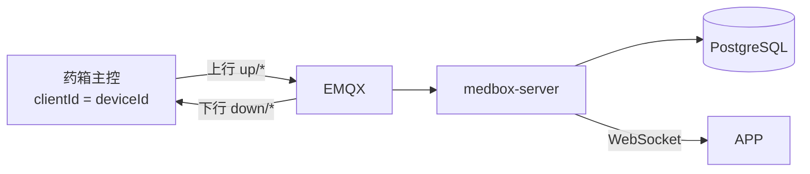

# 后端与单片机（药箱主控）· 联调调试测试流程

> 适用对象：药箱主控固件 ↔ EMQX ↔ `medbox-server` 的开发者与 QA。
> 协议契约以 [`medbox-spec/03`](../../medbox-spec/03_设备接入协议_MQTT.md)、[`medbox-spec/02b`](../../medbox-spec/02b_设备管理.md) 为准；**身份参数确认单、Topic/Payload 契约与报文示例见 [`docs/单片机与后端API对接.md`](../API与配置对接/单片机与后端API对接.md)**。本文聚焦调试命令与执行顺序。
> 三条边界：**后端不下发实时声光 / 解锁指令**（计划下发后设备本地闭环）；**服药事件不走 MQTT**（摄像头 HTTP 直报）；**后端只建模「格号 + 时间」**（1/2/3 = 早/中/晚，固件固定，后端不记录格内药品）。

---

## 0. 链路与命令速查



| 目的 | 命令 |
|------|------|
| 起 EMQX | `docker run -d --name emqx -p 1883:1883 -p 18083:18083 emqx/emqx:latest` |
| 起后端（MQTT 开） | `cd medbox-server && ./gradlew bootRun` |
| 订阅所有 topic（观察） | `mosquitto_sub -h localhost -t 'medbox/#' -v` |
| 模拟 MCU 上线 + 遥测 + 回执 | `cd medbox-server/tools/device-sim && npm run mcu -- --ack ok --duration-ms 90000` |
| 只验离线态 | `npm run mcu -- --offline --duration-ms 90000` |
| 模拟器单测 | `npm test` |
| 端到端冒烟 | `MEDBOX_DEVICE_SIM_SMOKE=true npm run smoke` |

统一变量：

```bash
BASE=http://localhost:8080/medbox/api/v1
DEVICE=BOXA-DEBUG-01
BROKER=tcp://localhost:1883
```

---

## 1. 准备

### 1.1 起依赖

```bash
cd medbox-server
docker compose up -d                                   # PostgreSQL
docker run -d --name emqx -p 1883:1883 -p 18083:18083 emqx/emqx:latest
# EMQX Dashboard: http://localhost:18083（默认 admin/public，务必改掉）
curl -s http://localhost:8080/medbox/actuator/health
```

后端 `medbox.mqtt.enabled` 默认 `true`，`broker=tcp://localhost:1883`，本期匿名连接。连不上只 WARN 并后台重连，**不阻塞启动**；不需要 MQTT 时 `MEDBOX_MQTT_ENABLED=false ./gradlew bootRun`。

> 不要把 1883 / 18083 映射到公网：匿名 broker 一旦对外，任何人都能订阅所有 topic、伪造设备数据。公共 WiFi 下演示用手机热点组网。

### 1.2 身份对齐（双方逐项确认）

| 项 | 取值 |
|----|------|
| 主控 `deviceId` = MQTT `clientId` | 固件生成并固化，4~64 位 `[A-Za-z0-9_-]`，全库唯一 |
| `productKey` | `medbox-box`（Topic 第 2 层） |
| 时区 | `Asia/Shanghai`（`slots[].time` 是设备本地墙钟 `HH:mm`） |
| `msgId` | `{deviceId}-{10位递增序号}`，序号持久化，重启不归零 |
| 药格 | `1` / `2` / `3` = 早 / 中 / 晚，固件固定，不可配置 |
| KeepAlive / LWT | 60s / topic `medbox/medbox-box/{deviceId}/status`，`{"online":false}` retained |

### 1.3 登记设备

方式 A：devtools 一键播种（推荐，含设备 + 计划）：

```bash
MEDBOX_DEVTOOLS_ENABLED=true ./gradlew bootRun
TOKEN=$(curl -s -X POST "$BASE/_debug/seed?reset=true" | jq -r '.data.guardianToken')
```

方式 B：真机正式登记（必须用监护人 token）：

```bash
TOKEN=$(curl -s -X POST "$BASE/auth/login" -H 'Content-Type: application/json' \
  -d '{"account":"13800001234","password":"123456"}' | jq -r '.data.token')

curl -s -X POST "$BASE/devices/register" \
  -H "Authorization: Bearer $TOKEN" -H 'Content-Type: application/json' \
  -d '{"deviceId":"BOXA1001","elderId":"e-1001","productKey":"medbox-box","timezone":"Asia/Shanghai"}' | jq

curl -s -H "Authorization: Bearer $TOKEN" "$BASE/devices/$DEVICE" | jq
```

登记规则：老人 token 调 register → `40301`；监护关系 PENDING → `40302`；编号已存在 → `40901`（不覆盖、不改绑，本期无解绑接口）；**未登记就发 MQTT 会被静默丢弃**，表现为"永远离线"。

### 1.4 装设备模拟器

```bash
cd medbox-server/tools/device-sim
npm install                 # 唯一依赖：mqtt
```

---

## 2. 观察手段（另开终端）

```bash
# 订阅所有上下行 + 状态（只有观察作用，不充当设备模拟）
mosquitto_sub -h localhost -t 'medbox/#' -v

# 服务端单发报文：走真实入站网关 → 落库 → WS 推送，但不建会话、不订阅 down/#、不回执
curl -s -X POST "$BASE/_debug/mqtt/publish" -H 'Content-Type: application/json' -d '{
  "deviceId":"BOXA-DEBUG-01",
  "subTopic":"telemetry/temperature",
  "payload":"{\"msgId\":\"BOXA-DEBUG-01-0000000123\",\"ts\":1759474487000,\"temperature\":26.5}" }'

# 查去重表（msgId 保留 7 天）
docker exec -e PGPASSWORD=mypassword medbox-pg psql -U myuser -d medbox \
  -c "select msg_id, topic, received_at from mqtt_message order by id desc limit 10;"
```

`_debug/mqtt/publish` 受 `medbox.devtools.enabled` 门禁；MQTT 未启 / 未连 broker 时返回 `50000`。

---

## 3. 调试流程（按验收顺序）

终端 A 常驻跑模拟器，终端 B 敲 REST 与观察命令。`--duration-ms 90000` 表示跑 90s 自动退出；`0`（默认）为常驻、Ctrl+C 退出。

### 3.1 上线 + 遥测

```bash
cd medbox-server/tools/device-sim
npm run mcu -- --device-id $DEVICE --broker $BROKER --duration-ms 90000
```

启动即做：`clientId=deviceId` 连接 → retained `{"online":true}` → 设 LWT → 订阅 `down/#` → 温湿 / 光照各发一条遥测。

验证：

```bash
curl -s -H "Authorization: Bearer $TOKEN" "$BASE/devices/$DEVICE/status" | jq
curl -s -H "Authorization: Bearer $TOKEN" "$BASE/devices/$DEVICE" | jq
```

期望：`ONLINE`、有最近心跳与温湿度 / 光照读数。

### 3.2 计划下发与回执

保持 3.1 的模拟器运行，另开终端：

```bash
TOKEN=$(curl -s -X POST "$BASE/auth/login" -H 'Content-Type: application/json' \
  -d '{"account":"13800001234","password":"123456"}' | jq -r '.data.token')

curl -s -H "Authorization: Bearer $TOKEN" "$BASE/plans/p-3301" | jq
curl -s -X POST -H "Authorization: Bearer $TOKEN" "$BASE/plans/p-3301/sync" | jq
```

| 模拟器启动方式 | 期望 |
|----------------|------|
| `--ack ok` | 日志出现 `up/ack` 且 `ackFor` 等于下行 `msgId`，计划状态 `SYNCED_TO_DEVICE` |
| `--ack fail` | 计划 `SYNC_FAILED` |
| `--ack silent` | 触发 5s × 3 重发，最终 `SYNC_FAILED` |

下行报文（观察）：

```json
{ "msgId":"d-001", "planId":"p-3301", "op":"UPSERT",
  "slots":[{"cellNo":1,"time":"08:00"},{"cellNo":2,"time":"12:30"}],
  "repeat":"DAILY", "alarm":{"missAfterMin":15}, "needAck":true }
```

保存计划后**立即下行一次**，不判断设备在线；QoS1 且 `retained=false`，设备离线时能否补收取决于 broker 会话。**联调时先上线再保存计划**。缺失的格号 = 该格当天不排程。

### 3.3 控制命令与终态

```bash
curl -s -X POST "$BASE/devices/$DEVICE/commands" \
  -H "Authorization: Bearer $TOKEN" -H 'Content-Type: application/json' \
  -d '{"cmd":"REBOOT","params":{}}' | jq

curl -s -H "Authorization: Bearer $TOKEN" "$BASE/devices/$DEVICE/events" | jq
```

命令白名单 `BUZZ` / `UNLOCK` / `REBOOT` / `CALIBRATE`；受理返回 `PENDING`，终态由 `up/ack` 翻转，在事件流水的 COMMAND 行看 `state=SUCCESS` / `FAILED`。设备离线时下发报 `40901`。

### 3.4 离线、异常与断网补传

```bash
# 只验离线态（不连 broker），主控 180s 未刷新心跳判离线并生成 DEVICE_OFFLINE
npm run mcu -- --device-id $DEVICE --offline --duration-ms 90000

# 额外发一条设备异常（DOOR_TIMEOUT / CAMERA_FAILED / HW_FAULT）
npm run mcu -- --device-id $DEVICE --error-type DOOR_TIMEOUT --duration-ms 90000
```

断网缓存 / 恢复补传**模拟器不实现**，需在真机上断网 → 恢复，观察数据补传与在线态恢复。

### 3.5 真机参数覆盖

```bash
npm run mcu -- \
  --device-id BOXA1001 \
  --broker tcp://192.168.1.9:1883 \
  --product-key medbox-box \
  --ack ok \
  --duration-ms 90000 \
  --state-dir .state
```

`--state-dir` 存 `msgId` 序号（已 gitignore），重启不归零；真机固件同样必须持久化。

---

## 4. 自动化测试（每次改动必跑，出报告）

```bash
cd medbox-server/tools/device-sim
npm test                                                        # 纯函数 + 本地假 HTTP 服务，无需 PG/EMQX
MEDBOX_DEVICE_SIM_SMOKE=true npm run smoke                      # 端到端：真 PG + EMQX + devtools 后端
MEDBOX_DEVICE_SIM_SMOKE=true MEDBOX_SIM_SMOKE_QUICK=true npm run smoke  # 只跑 ack=ok，跳过重发等待

cd ../.. && ./gradlew test                                      # 后端 L1
node medbox-app/tools/contract/run.mjs \
  --base http://127.0.0.1:8080/medbox/api/v1 --profile real      # 真后端契约
```

`smoke` 未设开关时直接跳过并退出 0（不会被 CI 误触发）；设置后逐场景打印 `ok` / `FAIL`，结尾 `结果: N 通过 / M 失败`。前置：PostgreSQL 17、EMQX、`SPRING_PROFILES_ACTIVE=local` 且 `medbox.devtools.enabled=true` 的后端、可写抓拍目录。

---

## 5. 排错表

| 现象 | 先查 |
|------|------|
| 设备一直离线 | ① 是否已登记；② `clientId` 是否等于 `deviceId`；③ EMQX Dashboard 是否真有这个连接 |
| 上行发了没反应 | ① 是否带 `msgId`；② `msgId` 是否重复（重启归零会命中旧记录，去重保留 7 天）；③ topic 是否 `medbox/{pk}/{deviceId}/up/...` |
| 下行收不到 | ① 固件订阅的 `productKey` 是否与登记时一致（后端按库里的 pk 发）；② 设备在线；③ 订阅了 `down/#` |
| 命令 / 计划不生效 | ① 命令要求在线，离线下发 `40901`；② 计划保存时离线、下行已丢（retained=false）；③ 上线后重新保存或调 `/sync` |
| 到点该格不动作 | ① 该 `cellNo` 是否在 `slots` 里；② 计划启用且 `SYNCED_TO_DEVICE`；③ 设备本地时钟 |
| `40901`（抓拍 / 命令） | 设备未登记（路径 `deviceId` 查不到）/ 设备离线 |
| `_debug/mqtt/publish` 返回 `50000` | EMQX 未起或后端连不上 broker |
| 设备页有数据但在线态不对 | 没发 retained 上线消息；任意上行也能刷新在线态 |
