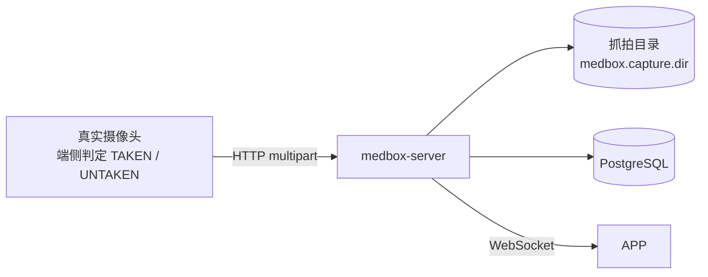

# 后端与摄像头 · 联调调试测试流程

> 适用对象：真实摄像头固件 ↔ `medbox-server` 的开发者与 QA。
> **联调以真实摄像头为主**：本文主线是让真机发 HTTP multipart 抓拍、后端落库与判定。`device-sim camera` 是 Mock 模拟对端，**只用于 CI 与自动化测试**（无真机时跑通链路 / 回归），不替代真机验收，见 §4。
> 契约口径以 [`../API与配置对接/摄像头与后端API对接.md`](../API与配置对接/摄像头与后端API对接.md)、[`medbox-spec/03`](../../medbox-spec/03_设备接入协议_MQTT.md) 第 4 章为准；接口见 `POST /api/v1/devices/{deviceId}/captures`。
> **关键边界：摄像头 HTTP multipart 直报后端，不经 MQTT、不经单片机中转；路径用主控 `deviceId`，没有摄像头子设备 ID，也没有 `X-Device-Id` 头。**

---

## 0. 链路与命令速查



| 目的 | 命令 |
|------|------|
| 起依赖与后端 | `cd medbox-server && docker compose up -d` → `MEDBOX_DEVTOOLS_ENABLED=true MEDBOX_CAPTURE_DIR=/tmp/medbox-captures ./gradlew bootRun` |
| 一键播种（拿 token / 计划） | `curl -s -X POST "$BASE/_debug/seed?reset=true" \| jq` |
| 真机上报 TAKEN | `curl -X POST "$BASE/devices/$DEVICE/captures" -F takenResult=TAKEN -F cellNo=1 -F planId=$PLAN ...` |
| 真机上报 UNTAKEN | 同上改 `-F takenResult=UNTAKEN -F file=@capture.jpg` |
| 验证抓拍 / 记录 / 告警 | `GET /captures`、`GET /records`、`GET /alarms?type=MISS` |
| Mock 摄像头（仅 CI / 自动化） | `cd medbox-server/tools/device-sim && npm run camera -- --capture taken`，见 §4 |

统一变量：

```bash
BASE=http://localhost:8080/medbox/api/v1
DEVICE=BOXA-DEBUG-01   # 联调真机换成已登记的主控 deviceId
ELDER=e-1001
PLAN=p-3301
```

---

## 1. 真机联调准备

### 1.1 起后端

```bash
cd medbox-server
docker compose up -d
MEDBOX_DEVTOOLS_ENABLED=true MEDBOX_CAPTURE_DIR=/tmp/medbox-captures ./gradlew bootRun
curl -s http://localhost:8080/medbox/actuator/health
```

- `medbox.capture.dir` 默认 `/var/medbox/captures`，本地机器常不可写，**联调务必覆盖成可写目录**（`UNTAKEN` 上传写文件失败会 500）。
- `max-file-size` / `max-request-size` 都是 10MB，真机单张抓拍不能超过 10MB。
- devtools 默认关闭，`_debug/seed` 必须 `medbox.devtools.enabled=true` 才装配；环境变量重启后生效。

```bash
TOKEN=$(curl -s -X POST "$BASE/_debug/seed?reset=true" | jq -r '.data.guardianToken')
```

### 1.2 真机接入确认

- [ ] 摄像头能访问 `http://<后端内网IP>:8080/medbox/api/v1`（与手机 APP 同一局域网）
- [ ] 上报路径用的**主控 `deviceId` 已登记**（未登记 → `40301`）
- [ ] 抓拍时间按设备本地墙钟换算后以 **ISO-8601 UTC**（`Z` 结尾）上报
- [ ] 固件发送的 multipart 字段与 §2 一致，`UNTAKEN` 会附原图
- [ ] 图片 ≤ 10MB

设备身份与抓拍约定（详见 API 对接文档）：

| 项 | 取值 |
|----|------|
| 路径 `deviceId` | 药箱主控 ID（seed 为 `BOXA-DEBUG-01`），**不是摄像头子设备 ID** |
| 鉴权 | 不需要用户 JWT；后端按路径 `deviceId` 解析归属老人 |
| 表单字段 | `cellNo`（1/2/3，`planId` 非空时必带）、`takenResult`（`TAKEN`/`UNTAKEN`）、`planId`、`capturedAt`（ISO-8601 UTC）、`reason`（`NORMAL`/`MANUAL`） |
| 图片 | `TAKEN` **不带图**；`UNTAKEN` **必须带 `file`** |
| 去重 | 同一 `planId + cellNo` 60s 内只保留第一条；同一计划同一格同一时间槽只落一条记录 |

---

## 2. 真机抓拍联调（主线）

> 下面的 `curl` 是**真机固件实际请求的契约对照**：固件发出去的 multipart 字段应与之一致。排障时可在电脑上运行同样的 curl 做交叉验证，确认"后端正常、问题在固件侧"。

### 2.1 已取药 TAKEN

真机到点检测到该格被取走 → 上报 `TAKEN`，**不附图**。

```bash
curl -s -X POST "$BASE/devices/$DEVICE/captures" \
  -F reason=NORMAL -F planId=$PLAN -F cellNo=1 \
  -F takenResult=TAKEN -F capturedAt=2026-11-12T08:00:30Z | jq
```

验收：记录页出现「已取药」，显示对应格号与按时 / 未按时；响应无 `sizeBytes` / 无 `fileToken`（`mime` 可能因 DB 默认值仍回显 `image/jpeg`，不代表真有文件）。

### 2.2 未取药 UNTAKEN

真机到点检测该格未被取走 → 上报 `UNTAKEN`，**附抓拍原图留证**。

```bash
curl -s -X POST "$BASE/devices/$DEVICE/captures" \
  -F reason=NORMAL -F planId=$PLAN -F cellNo=1 \
  -F takenResult=UNTAKEN -F capturedAt=2026-11-12T08:00:30Z \
  -F file=@/path/to/capture.jpg | jq
```

验收：记录页出现「未取药」+ 抓拍原图，`sizeBytes > 0`、`fileToken` 可用。

### 2.3 到点未上报 → 漏服

真机侧到点后**不触发上报**（或上报丢失且未补报），保持设备在线：

验收：超容忍窗口（扫描间隔 60s）后生成 `MISS`，消息只写「时间 + 格号」（如「08:00 1 号格（早间）未按时取药」），不提药名。设备离线时默认**不判漏服**（`skip-when-device-offline: true`），避免"上报不了 = 漏服"误报。

### 2.4 错误路径

```bash
# 未登记设备 → 40301
curl -s -X POST "$BASE/devices/NOT-REGISTERED/captures" \
  -F takenResult=TAKEN -F cellNo=1 -F planId=$PLAN | jq

# planId 非空但缺 cellNo → 40001
curl -s -X POST "$BASE/devices/$DEVICE/captures" \
  -F takenResult=TAKEN -F planId=$PLAN | jq

# UNTAKEN 没带 file → 40001
curl -s -X POST "$BASE/devices/$DEVICE/captures" \
  -F takenResult=UNTAKEN -F cellNo=1 -F planId=$PLAN | jq
```

### 2.5 真机联调注意

- 连续自测不同结论要**换 `cellNo` 或时间槽**：同一 `planId + cellNo` 60s 内重复上报只保留第一条。
- `onTime` 由后端按 `ts` 与计划时间 + 容忍现算，payload 里传 `onTime` 无效；设备本地墙钟需对准（默认 Asia/Shanghai）。
- 已上报 `UNTAKEN` 的会落在记录里并附抓拍图，**不重复生成漏服告警**。

---

## 3. 验证命令

```bash
# 抓拍列表 / 详情（详情含 fileToken，5 分钟有效）
curl -s -H "Authorization: Bearer $TOKEN" "$BASE/captures?elderId=$ELDER" | jq
CAPTURE=$(curl -s -H "Authorization: Bearer $TOKEN" "$BASE/captures?elderId=$ELDER" \
  | jq -r '.data.list[0].captureId')
curl -s -H "Authorization: Bearer $TOKEN" "$BASE/captures/$CAPTURE" | jq

# 取图片流（二进制，不走统一响应体；token 来自详情的 fileToken）
FILE_TOKEN=$(curl -s -H "Authorization: Bearer $TOKEN" "$BASE/captures/$CAPTURE" \
  | jq -r '.data.fileToken')
curl -s -o /tmp/medbox-capture.jpg "$BASE/captures/$CAPTURE/file?token=$FILE_TOKEN"
file /tmp/medbox-capture.jpg

# 服药记录：已取药 / 未取药结论 + 按时判定
curl -s -H "Authorization: Bearer $TOKEN" "$BASE/records?elderId=$ELDER" | jq
curl -s -H "Authorization: Bearer $TOKEN" "$BASE/records/export?elderId=$ELDER" -o /tmp/records.csv

# 漏服告警
curl -s -H "Authorization: Bearer $TOKEN" "$BASE/alarms?elderId=$ELDER&type=MISS" | jq

# 落库核对（可选）
docker exec -e PGPASSWORD=mypassword medbox-pg psql -U myuser -d medbox \
  -c "select capture_id, cell_no, taken_result, size_bytes, captured_at from capture order by id desc limit 10;"
```

---

## 4. Mock 摄像头（仅 CI 与自动化测试）

> `device-sim camera` 是**模拟设备对端**，自动构造字段与留证图，**不覆盖真机的图像识别、网络链路和抓拍时机**。它用于 CI 与自动化测试中跑通「抓拍 → 落库 → 判定 → 推送」链路、回归错误路径；**联调验收请用 §2 的真机流程**。

```bash
cd medbox-server/tools/device-sim
npm install

# 已取药：TAKEN 不附图
npm run camera -- --device-id $DEVICE --plan-id $PLAN --cell-no 1 \
  --capture taken --reason NORMAL --captured-at 2026-11-12T08:00:30Z

# 未取药：UNTAKEN 自动生成 1×1 JPEG 留证图
npm run camera -- --device-id $DEVICE --plan-id $PLAN --cell-no 1 --capture untaken

# 到点不上报（交给后端扫描判 MISS）
npm run camera -- --device-id $DEVICE --capture none

# 错误路径：未登记设备 → 40301
npm run camera -- --device-id $DEVICE --unknown-device
```

常用开关：`--base-url URL`（默认 `http://localhost:8080/medbox/api/v1`）、`--device-id`、`--plan-id`、`--cell-no 1|2|3`、`--reason NORMAL|MANUAL`、`--captured-at ISO-8601`。

自动化测试（每次改动必跑，出报告）：

```bash
npm test                                                        # 纯函数 + 本地假 HTTP 服务，无需 PG/EMQX
MEDBOX_DEVICE_SIM_SMOKE=true npm run smoke                      # 端到端（含抓拍），需 PG + EMQX + devtools 后端
MEDBOX_DEVICE_SIM_SMOKE=true MEDBOX_SIM_SMOKE_QUICK=true npm run smoke

cd ../.. && ./gradlew test                                      # 后端 L1
node medbox-app/tools/contract/run.mjs \
  --base http://127.0.0.1:8080/medbox/api/v1 --profile real      # 真后端契约回归
```

`smoke` 未设开关时直接跳过并退出 0；设置后逐场景打印 `ok` / `FAIL`，结尾 `结果: N 通过 / M 失败`，有失败退出码 1。

---

## 5. 排错表

| 现象 | 先查 |
|------|------|
| 抓拍 `40301` | 路径 `deviceId` 未登记（不是摄像头 ID），先 `POST /devices/register` 或跑 seed |
| 抓拍 `40001` | `planId` 非空时 `cellNo` 缺失 / 越界（只能 1/2/3）；`UNTAKEN` 没带 `file` |
| 上传 500 | `medbox.capture.dir` 不可写，或文件 > 10MB |
| 同一格连报两次只生效一次 | 60s 去重 + `(plan_item_id, plan_time)` 唯一约束，换 `cellNo` 或时间槽 |
| `fileToken` 失效 40101 | 只有 5 分钟有效期，重新查详情取新 token |
| `TAKEN` 却回显 `mime=image/jpeg` | DB 默认值所致，看 `sizeBytes` / `fileToken` 是否为空判断有无文件 |
| 没生成漏服告警 | ① 容忍窗口未到（扫描间隔 60s）；② 设备离线默认跳过；③ 已有该时间槽的记录则不判 MISS |
| 记录 `onTime=false` 不符合预期 | `onTime` 由后端按 `ts` 与计划时间 + 容忍现算，payload 里传的 `onTime` 被忽略；`capturedAt` 用 UTC，设备本地墙钟按 UTC+8 换算 |
